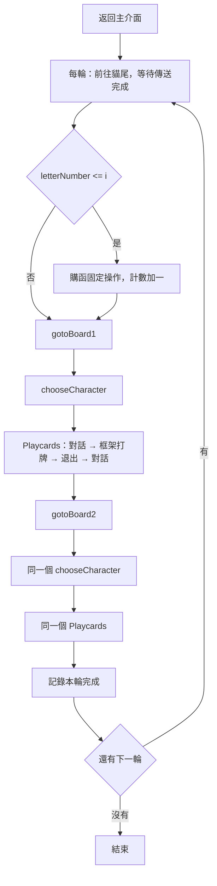

原版「七聖召喚角色邀約全自動」完整逐行用途報告

本報告於 2026-10-23（UTC）重新讀取使用者連結的 `main`。當時分支指向 `879bd43edcbceea4d13c20cede89f3d63c09ce52`；以下來源連結固定到這個提交，避免日後 main 更新導致行號變動。這是 scripts-list 儲存庫當時的分支提交，不代表本資料夾最後修改時間。

已核對資料夾與 assets 清單：只有下列六個檔案。四份文字檔共 **247 行**，全部逐行列在下方，包含空行、註解與結構邊界；兩張 PNG 另外說明。六個檔案與本專案先前固定於 `9756c1b6608eec84515dac63e2517b1fd6266af4` 的原版副本逐位元組相同。因此不是本次 main 已換成另一套邀約流程。

| 原檔 | 行數／大小 | 用途 |
|---|---:|---|
| [main.js](https://github.com/babalae/bettergi-scripts-list/blob/879bd43edcbceea4d13c20cede89f3d63c09ce52/repo/js/%E4%B8%83%E5%9C%A3%E5%8F%AC%E5%94%A4%E8%A7%92%E8%89%B2%E9%82%80%E7%BA%A6%E5%85%A8%E8%87%AA%E5%8A%A8/main.js) | 197 行 | 整體操作流程與框架打牌呼叫 |
| [settings.json](https://github.com/babalae/bettergi-scripts-list/blob/879bd43edcbceea4d13c20cede89f3d63c09ce52/repo/js/%E4%B8%83%E5%9C%A3%E5%8F%AC%E5%94%A4%E8%A7%92%E8%89%B2%E9%82%80%E7%BA%A6%E5%85%A8%E8%87%AA%E5%8A%A8/settings.json) | 12 行 | 兩個使用者輸入欄位 |
| [manifest.json](https://github.com/babalae/bettergi-scripts-list/blob/879bd43edcbceea4d13c20cede89f3d63c09ce52/repo/js/%E4%B8%83%E5%9C%A3%E5%8F%AC%E5%94%A4%E8%A7%92%E8%89%B2%E9%82%80%E7%BA%A6%E5%85%A8%E8%87%AA%E5%8A%A8/manifest.json) | 17 行 | 腳本名稱、版本、作者與入口 |
| [assets/1.json](https://github.com/babalae/bettergi-scripts-list/blob/879bd43edcbceea4d13c20cede89f3d63c09ce52/repo/js/%E4%B8%83%E5%9C%A3%E5%8F%AC%E5%94%A4%E8%A7%92%E8%89%B2%E9%82%80%E7%BA%A6%E5%85%A8%E8%87%AA%E5%8A%A8/assets/1.json) | 21 行 | 未被主程式使用的路徑資料 |
| [assets/talkSymbol.png](https://github.com/babalae/bettergi-scripts-list/blob/879bd43edcbceea4d13c20cede89f3d63c09ce52/repo/js/%E4%B8%83%E5%9C%A3%E5%8F%AC%E5%94%A4%E8%A7%92%E8%89%B2%E9%82%80%E7%BA%A6%E5%85%A8%E8%87%AA%E5%8A%A8/assets/talkSymbol.png) | 1332 bytes | 對話標誌模板，30×24 像素 |
| [assets/tavern.png](https://github.com/babalae/bettergi-scripts-list/blob/879bd43edcbceea4d13c20cede89f3d63c09ce52/repo/js/%E4%B8%83%E5%9C%A3%E5%8F%AC%E5%94%A4%E8%A7%92%E8%89%B2%E9%82%80%E7%BA%A6%E5%85%A8%E8%87%AA%E5%8A%A8/assets/tavern.png) | 2200 bytes | 貓尾圖示模板，34×34 像素 |

程式本身是一個按固定順序操作的 JS 外層腳本；真正打牌由 BetterGI 的 `AutoGeniusInvokation` 任務執行。主程式直接可見的畫面辨識只有三處：第 9–25 行的隊伍區 OCR、第 90–114 行的對話圖示模板、第 119–141 行的酒館圖示模板。這個結論只限定本腳本，並不表示 BetterGI 框架的內部任務沒有其他辨識。

實際呼叫順序如下；函式宣告本身不會提前執行。圖中兩次 chooseCharacter/Playcards 是同一組函式。



**main.js：197 行逐行用途。** 每個行號可直接開啟對應原碼；表中的程式碼保留原行內容，僅去除行首／行尾空白以便閱讀。

| 行 | 原始碼 | 用途 |
|---:|---|---|
| [1](https://github.com/babalae/bettergi-scripts-list/blob/879bd43edcbceea4d13c20cede89f3d63c09ce52/repo/js/%E4%B8%83%E5%9C%A3%E5%8F%AC%E5%94%A4%E8%A7%92%E8%89%B2%E9%82%80%E7%BA%A6%E5%85%A8%E8%87%AA%E5%8A%A8/main.js#L1) | <code>(async function () {</code> | 建立非同步立即執行函式的作用域；在第 197 行結尾呼叫，讓整份流程可以使用 await。 |
| [2](https://github.com/babalae/bettergi-scripts-list/blob/879bd43edcbceea4d13c20cede89f3d63c09ce52/repo/js/%E4%B8%83%E5%9C%A3%E5%8F%AC%E5%94%A4%E8%A7%92%E8%89%B2%E9%82%80%E7%BA%A6%E5%85%A8%E8%87%AA%E5%8A%A8/main.js#L2) | （空行） | 空行，僅分隔程式區塊，不執行任何操作。 |
| [3](https://github.com/babalae/bettergi-scripts-list/blob/879bd43edcbceea4d13c20cede89f3d63c09ce52/repo/js/%E4%B8%83%E5%9C%A3%E5%8F%AC%E5%94%A4%E8%A7%92%E8%89%B2%E9%82%80%E7%BA%A6%E5%85%A8%E8%87%AA%E5%8A%A8/main.js#L3) | <code>//读取配置</code> | 註解：以下讀取調度器自訂設定；註解本身不執行。 |
| [4](https://github.com/babalae/bettergi-scripts-list/blob/879bd43edcbceea4d13c20cede89f3d63c09ce52/repo/js/%E4%B8%83%E5%9C%A3%E5%8F%AC%E5%94%A4%E8%A7%92%E8%89%B2%E9%82%80%E7%BA%A6%E5%85%A8%E8%87%AA%E5%8A%A8/main.js#L4) | <code>let letterNumber = settings.letterNumber != undefined &amp;&amp; ~~settings.letterNumber &gt;= 0 ? ~~settings.letterNumber : 0;</code> | 讀 letterNumber；設定存在且經 ~~ 轉為非負整數時使用該值，否則用 0。~~ 是 JavaScript 的 32 位有號整數轉換，不是完整的輸入驗證。這是使用者提供的計數，不是讀遊戲庫存。 |
| [5](https://github.com/babalae/bettergi-scripts-list/blob/879bd43edcbceea4d13c20cede89f3d63c09ce52/repo/js/%E4%B8%83%E5%9C%A3%E5%8F%AC%E5%94%A4%E8%A7%92%E8%89%B2%E9%82%80%E7%BA%A6%E5%85%A8%E8%87%AA%E5%8A%A8/main.js#L5) | <code>let challengeNumber = settings.challengeNumber != undefined &amp;&amp; ~~settings.challengeNumber &gt; 0 ? ~~settings.challengeNumber : 1;</code> | 讀 challengeNumber；設定存在且經 ~~ 轉為正整數時使用該值，否則用 1。後面它控制外層輪數，每輪會呼叫兩次打牌函式。 |
| [6](https://github.com/babalae/bettergi-scripts-list/blob/879bd43edcbceea4d13c20cede89f3d63c09ce52/repo/js/%E4%B8%83%E5%9C%A3%E5%8F%AC%E5%94%A4%E8%A7%92%E8%89%B2%E9%82%80%E7%BA%A6%E5%85%A8%E8%87%AA%E5%8A%A8/main.js#L6) | （空行） | 空行，僅分隔程式區塊，不執行任何操作。 |
| [7](https://github.com/babalae/bettergi-scripts-list/blob/879bd43edcbceea4d13c20cede89f3d63c09ce52/repo/js/%E4%B8%83%E5%9C%A3%E5%8F%AC%E5%94%A4%E8%A7%92%E8%89%B2%E9%82%80%E7%BA%A6%E5%85%A8%E8%87%AA%E5%8A%A8/main.js#L7) | <code>//检测传送结束</code> | 註解：接下來宣告傳送完成檢測。 |
| [8](https://github.com/babalae/bettergi-scripts-list/blob/879bd43edcbceea4d13c20cede89f3d63c09ce52/repo/js/%E4%B8%83%E5%9C%A3%E5%8F%AC%E5%94%A4%E8%A7%92%E8%89%B2%E9%82%80%E7%BA%A6%E5%85%A8%E8%87%AA%E5%8A%A8/main.js#L8) | <code>async function tpEndDetection() {</code> | 宣告 tpEndDetection()；宣告時不執行，直到第 145 行被 await 呼叫。 |
| [9](https://github.com/babalae/bettergi-scripts-list/blob/879bd43edcbceea4d13c20cede89f3d63c09ce52/repo/js/%E4%B8%83%E5%9C%A3%E5%8F%AC%E5%94%A4%E8%A7%92%E8%89%B2%E9%82%80%E7%BA%A6%E5%85%A8%E8%87%AA%E5%8A%A8/main.js#L9) | <code>const region = RecognitionObject.ocr(1690, 230, 75, 350); // 队伍名称区域</code> | 建立右側隊伍名稱區的 OCR 規則：左上 (1690,230)，寬 75、高 350。沒有指定必須讀到哪個角色名字。 |
| [10](https://github.com/babalae/bettergi-scripts-list/blob/879bd43edcbceea4d13c20cede89f3d63c09ce52/repo/js/%E4%B8%83%E5%9C%A3%E5%8F%AC%E5%94%A4%E8%A7%92%E8%89%B2%E9%82%80%E7%BA%A6%E5%85%A8%E8%87%AA%E5%8A%A8/main.js#L10) | <code>let tpTime = 0;</code> | 初始化檢測輪數 tpTime = 0。這不是時間戳。 |
| [11](https://github.com/babalae/bettergi-scripts-list/blob/879bd43edcbceea4d13c20cede89f3d63c09ce52/repo/js/%E4%B8%83%E5%9C%A3%E5%8F%AC%E5%94%A4%E8%A7%92%E8%89%B2%E9%82%80%E7%BA%A6%E5%85%A8%E8%87%AA%E5%8A%A8/main.js#L11) | <code>await sleep(500); //点击传送后等待一段时间避免误判</code> | 開始檢測前先等 500 毫秒，避開點擊後的瞬間畫面。 |
| [12](https://github.com/babalae/bettergi-scripts-list/blob/879bd43edcbceea4d13c20cede89f3d63c09ce52/repo/js/%E4%B8%83%E5%9C%A3%E5%8F%AC%E5%94%A4%E8%A7%92%E8%89%B2%E9%82%80%E7%BA%A6%E5%85%A8%E8%87%AA%E5%8A%A8/main.js#L12) | <code>//最多30秒传送时间</code> | 註解稱「最多 30 秒」；實際是最多 300 次辨識加每次 100 毫秒等待，辨識耗時另計。 |
| [13](https://github.com/babalae/bettergi-scripts-list/blob/879bd43edcbceea4d13c20cede89f3d63c09ce52/repo/js/%E4%B8%83%E5%9C%A3%E5%8F%AC%E5%94%A4%E8%A7%92%E8%89%B2%E9%82%80%E7%BA%A6%E5%85%A8%E8%87%AA%E5%8A%A8/main.js#L13) | <code>while (tpTime &lt; 300) {</code> | 只要 tpTime 小於 300 就繼續檢測，最多執行 300 輪。 |
| [14](https://github.com/babalae/bettergi-scripts-list/blob/879bd43edcbceea4d13c20cede89f3d63c09ce52/repo/js/%E4%B8%83%E5%9C%A3%E5%8F%AC%E5%94%A4%E8%A7%92%E8%89%B2%E9%82%80%E7%BA%A6%E5%85%A8%E8%87%AA%E5%8A%A8/main.js#L14) | <code>let capture = captureGameRegion();</code> | 擷取目前遊戲畫面。 |
| [15](https://github.com/babalae/bettergi-scripts-list/blob/879bd43edcbceea4d13c20cede89f3d63c09ce52/repo/js/%E4%B8%83%E5%9C%A3%E5%8F%AC%E5%94%A4%E8%A7%92%E8%89%B2%E9%82%80%E7%BA%A6%E5%85%A8%E8%87%AA%E5%8A%A8/main.js#L15) | <code>let res = capture.find(region);</code> | 在該畫面使用第 9 行的局部 OCR 規則尋找結果。 |
| [16](https://github.com/babalae/bettergi-scripts-list/blob/879bd43edcbceea4d13c20cede89f3d63c09ce52/repo/js/%E4%B8%83%E5%9C%A3%E5%8F%AC%E5%94%A4%E8%A7%92%E8%89%B2%E9%82%80%E7%BA%A6%E5%85%A8%E8%87%AA%E5%8A%A8/main.js#L16) | <code>capture.dispose();</code> | 釋放這次截圖資源；不是關閉遊戲畫面。 |
| [17](https://github.com/babalae/bettergi-scripts-list/blob/879bd43edcbceea4d13c20cede89f3d63c09ce52/repo/js/%E4%B8%83%E5%9C%A3%E5%8F%AC%E5%94%A4%E8%A7%92%E8%89%B2%E9%82%80%E7%BA%A6%E5%85%A8%E8%87%AA%E5%8A%A8/main.js#L17) | <code>if (!res.isEmpty()) {</code> | 若 OCR 結果不為空，就視為已恢復可見的隊伍區域；沒有比對具體文字，也沒有讀取傳送進度百分比。 |
| [18](https://github.com/babalae/bettergi-scripts-list/blob/879bd43edcbceea4d13c20cede89f3d63c09ce52/repo/js/%E4%B8%83%E5%9C%A3%E5%8F%AC%E5%94%A4%E8%A7%92%E8%89%B2%E9%82%80%E7%BA%A6%E5%85%A8%E8%87%AA%E5%8A%A8/main.js#L18) | <code>log.info(&quot;传送完成&quot;);</code> | 輸出「傳送完成」日誌。 |
| [19](https://github.com/babalae/bettergi-scripts-list/blob/879bd43edcbceea4d13c20cede89f3d63c09ce52/repo/js/%E4%B8%83%E5%9C%A3%E5%8F%AC%E5%94%A4%E8%A7%92%E8%89%B2%E9%82%80%E7%BA%A6%E5%85%A8%E8%87%AA%E5%8A%A8/main.js#L19) | <code>await sleep(1200); //传送结束后有僵直</code> | 再等 1200 毫秒，避開傳送結束後的僵直。 |
| [20](https://github.com/babalae/bettergi-scripts-list/blob/879bd43edcbceea4d13c20cede89f3d63c09ce52/repo/js/%E4%B8%83%E5%9C%A3%E5%8F%AC%E5%94%A4%E8%A7%92%E8%89%B2%E9%82%80%E7%BA%A6%E5%85%A8%E8%87%AA%E5%8A%A8/main.js#L20) | <code>return;</code> | 結束傳送檢測，回到 gotoTavern() 的呼叫處。 |
| [21](https://github.com/babalae/bettergi-scripts-list/blob/879bd43edcbceea4d13c20cede89f3d63c09ce52/repo/js/%E4%B8%83%E5%9C%A3%E5%8F%AC%E5%94%A4%E8%A7%92%E8%89%B2%E9%82%80%E7%BA%A6%E5%85%A8%E8%87%AA%E5%8A%A8/main.js#L21) | <code>}</code> | 結束第 17 行的成功分支。 |
| [22](https://github.com/babalae/bettergi-scripts-list/blob/879bd43edcbceea4d13c20cede89f3d63c09ce52/repo/js/%E4%B8%83%E5%9C%A3%E5%8F%AC%E5%94%A4%E8%A7%92%E8%89%B2%E9%82%80%E7%BA%A6%E5%85%A8%E8%87%AA%E5%8A%A8/main.js#L22) | <code>tpTime++;</code> | 本輪未成功，檢測次數加一。 |
| [23](https://github.com/babalae/bettergi-scripts-list/blob/879bd43edcbceea4d13c20cede89f3d63c09ce52/repo/js/%E4%B8%83%E5%9C%A3%E5%8F%AC%E5%94%A4%E8%A7%92%E8%89%B2%E9%82%80%E7%BA%A6%E5%85%A8%E8%87%AA%E5%8A%A8/main.js#L23) | <code>await sleep(100);</code> | 等待 100 毫秒後再檢測；不是每輪固定只耗 100 毫秒。 |
| [24](https://github.com/babalae/bettergi-scripts-list/blob/879bd43edcbceea4d13c20cede89f3d63c09ce52/repo/js/%E4%B8%83%E5%9C%A3%E5%8F%AC%E5%94%A4%E8%A7%92%E8%89%B2%E9%82%80%E7%BA%A6%E5%85%A8%E8%87%AA%E5%8A%A8/main.js#L24) | <code>}</code> | 結束本次 while 迴圈主體。 |
| [25](https://github.com/babalae/bettergi-scripts-list/blob/879bd43edcbceea4d13c20cede89f3d63c09ce52/repo/js/%E4%B8%83%E5%9C%A3%E5%8F%AC%E5%94%A4%E8%A7%92%E8%89%B2%E9%82%80%E7%BA%A6%E5%85%A8%E8%87%AA%E5%8A%A8/main.js#L25) | <code>throw new Error(&quot;传送时间超时&quot;);</code> | 300 輪都未成功時拋出「傳送時間超時」例外。外層沒有捕捉它，任務會中斷。 |
| [26](https://github.com/babalae/bettergi-scripts-list/blob/879bd43edcbceea4d13c20cede89f3d63c09ce52/repo/js/%E4%B8%83%E5%9C%A3%E5%8F%AC%E5%94%A4%E8%A7%92%E8%89%B2%E9%82%80%E7%BA%A6%E5%85%A8%E8%87%AA%E5%8A%A8/main.js#L26) | <code>}</code> | 結束 tpEndDetection() 宣告。 |
| [27](https://github.com/babalae/bettergi-scripts-list/blob/879bd43edcbceea4d13c20cede89f3d63c09ce52/repo/js/%E4%B8%83%E5%9C%A3%E5%8F%AC%E5%94%A4%E8%A7%92%E8%89%B2%E9%82%80%E7%BA%A6%E5%85%A8%E8%87%AA%E5%8A%A8/main.js#L27) | （空行） | 空行，僅分隔程式區塊，不執行任何操作。 |
| [28](https://github.com/babalae/bettergi-scripts-list/blob/879bd43edcbceea4d13c20cede89f3d63c09ce52/repo/js/%E4%B8%83%E5%9C%A3%E5%8F%AC%E5%94%A4%E8%A7%92%E8%89%B2%E9%82%80%E7%BA%A6%E5%85%A8%E8%87%AA%E5%8A%A8/main.js#L28) | <code>//函数：找小王子买邀请函</code> | 註解：以下是找小王子購買邀請函的操作路線。 |
| [29](https://github.com/babalae/bettergi-scripts-list/blob/879bd43edcbceea4d13c20cede89f3d63c09ce52/repo/js/%E4%B8%83%E5%9C%A3%E5%8F%AC%E5%94%A4%E8%A7%92%E8%89%B2%E9%82%80%E7%BA%A6%E5%85%A8%E8%87%AA%E5%8A%A8/main.js#L29) | <code>async function BuyLetter(){</code> | 宣告 BuyLetter()；本函式不自己判斷持有數，只在外層排程呼叫時購買。 |
| [30](https://github.com/babalae/bettergi-scripts-list/blob/879bd43edcbceea4d13c20cede89f3d63c09ce52/repo/js/%E4%B8%83%E5%9C%A3%E5%8F%AC%E5%94%A4%E8%A7%92%E8%89%B2%E9%82%80%E7%BA%A6%E5%85%A8%E8%87%AA%E5%8A%A8/main.js#L30) | <code>await sleep(700);</code> | 購函操作前等待 700 毫秒。 |
| [31](https://github.com/babalae/bettergi-scripts-list/blob/879bd43edcbceea4d13c20cede89f3d63c09ce52/repo/js/%E4%B8%83%E5%9C%A3%E5%8F%AC%E5%94%A4%E8%A7%92%E8%89%B2%E9%82%80%E7%BA%A6%E5%85%A8%E8%87%AA%E5%8A%A8/main.js#L31) | <code>keyDown(&quot;w&quot;);</code> | 按住 W，開始向前走；實際落點依呼叫時的位置及朝向而定。 |
| [32](https://github.com/babalae/bettergi-scripts-list/blob/879bd43edcbceea4d13c20cede89f3d63c09ce52/repo/js/%E4%B8%83%E5%9C%A3%E5%8F%AC%E5%94%A4%E8%A7%92%E8%89%B2%E9%82%80%E7%BA%A6%E5%85%A8%E8%87%AA%E5%8A%A8/main.js#L32) | <code>await sleep(1400);</code> | 保持 W 按住 1400 毫秒。 |
| [33](https://github.com/babalae/bettergi-scripts-list/blob/879bd43edcbceea4d13c20cede89f3d63c09ce52/repo/js/%E4%B8%83%E5%9C%A3%E5%8F%AC%E5%94%A4%E8%A7%92%E8%89%B2%E9%82%80%E7%BA%A6%E5%85%A8%E8%87%AA%E5%8A%A8/main.js#L33) | <code>keyUp(&quot;w&quot;);</code> | 放開 W，停止本段向前移動。 |
| [34](https://github.com/babalae/bettergi-scripts-list/blob/879bd43edcbceea4d13c20cede89f3d63c09ce52/repo/js/%E4%B8%83%E5%9C%A3%E5%8F%AC%E5%94%A4%E8%A7%92%E8%89%B2%E9%82%80%E7%BA%A6%E5%85%A8%E8%87%AA%E5%8A%A8/main.js#L34) | <code>await sleep(2000);</code> | 等待 2000 毫秒。 |
| [35](https://github.com/babalae/bettergi-scripts-list/blob/879bd43edcbceea4d13c20cede89f3d63c09ce52/repo/js/%E4%B8%83%E5%9C%A3%E5%8F%AC%E5%94%A4%E8%A7%92%E8%89%B2%E9%82%80%E7%BA%A6%E5%85%A8%E8%87%AA%E5%8A%A8/main.js#L35) | <code>keyPress(&quot;F&quot;);</code> | 短按 F，觸發當前位置的互動；沒有辨識互動對象姓名。 |
| [36](https://github.com/babalae/bettergi-scripts-list/blob/879bd43edcbceea4d13c20cede89f3d63c09ce52/repo/js/%E4%B8%83%E5%9C%A3%E5%8F%AC%E5%94%A4%E8%A7%92%E8%89%B2%E9%82%80%E7%BA%A6%E5%85%A8%E8%87%AA%E5%8A%A8/main.js#L36) | <code>await sleep(2000);</code> | 等待 2000 毫秒，讓互動畫面出現。 |
| [37](https://github.com/babalae/bettergi-scripts-list/blob/879bd43edcbceea4d13c20cede89f3d63c09ce52/repo/js/%E4%B8%83%E5%9C%A3%E5%8F%AC%E5%94%A4%E8%A7%92%E8%89%B2%E9%82%80%E7%BA%A6%E5%85%A8%E8%87%AA%E5%8A%A8/main.js#L37) | <code>click(900, 1000);//对话</code> | 第一次固定點擊 (900,1000) 推進對話；沒有辨識台詞或選項。 |
| [38](https://github.com/babalae/bettergi-scripts-list/blob/879bd43edcbceea4d13c20cede89f3d63c09ce52/repo/js/%E4%B8%83%E5%9C%A3%E5%8F%AC%E5%94%A4%E8%A7%92%E8%89%B2%E9%82%80%E7%BA%A6%E5%85%A8%E8%87%AA%E5%8A%A8/main.js#L38) | <code>await sleep(500);</code> | 等待 500 毫秒。 |
| [39](https://github.com/babalae/bettergi-scripts-list/blob/879bd43edcbceea4d13c20cede89f3d63c09ce52/repo/js/%E4%B8%83%E5%9C%A3%E5%8F%AC%E5%94%A4%E8%A7%92%E8%89%B2%E9%82%80%E7%BA%A6%E5%85%A8%E8%87%AA%E5%8A%A8/main.js#L39) | <code>click(900, 1000);//对话</code> | 第二次點擊同一對話推進位置 (900,1000)。 |
| [40](https://github.com/babalae/bettergi-scripts-list/blob/879bd43edcbceea4d13c20cede89f3d63c09ce52/repo/js/%E4%B8%83%E5%9C%A3%E5%8F%AC%E5%94%A4%E8%A7%92%E8%89%B2%E9%82%80%E7%BA%A6%E5%85%A8%E8%87%AA%E5%8A%A8/main.js#L40) | <code>await sleep(500);</code> | 等待 500 毫秒。 |
| [41](https://github.com/babalae/bettergi-scripts-list/blob/879bd43edcbceea4d13c20cede89f3d63c09ce52/repo/js/%E4%B8%83%E5%9C%A3%E5%8F%AC%E5%94%A4%E8%A7%92%E8%89%B2%E9%82%80%E7%BA%A6%E5%85%A8%E8%87%AA%E5%8A%A8/main.js#L41) | <code>click(900, 1000);//对话</code> | 第三次點擊同一對話推進位置 (900,1000)。 |
| [42](https://github.com/babalae/bettergi-scripts-list/blob/879bd43edcbceea4d13c20cede89f3d63c09ce52/repo/js/%E4%B8%83%E5%9C%A3%E5%8F%AC%E5%94%A4%E8%A7%92%E8%89%B2%E9%82%80%E7%BA%A6%E5%85%A8%E8%87%AA%E5%8A%A8/main.js#L42) | <code>await sleep(1000);</code> | 等待 1000 毫秒。 |
| [43](https://github.com/babalae/bettergi-scripts-list/blob/879bd43edcbceea4d13c20cede89f3d63c09ce52/repo/js/%E4%B8%83%E5%9C%A3%E5%8F%AC%E5%94%A4%E8%A7%92%E8%89%B2%E9%82%80%E7%BA%A6%E5%85%A8%E8%87%AA%E5%8A%A8/main.js#L43) | <code>click(1355,650);//进入商店</code> | 固定點擊 (1355,650)，作者註解意圖是進入商店；程式沒有先核對按鈕文字。 |
| [44](https://github.com/babalae/bettergi-scripts-list/blob/879bd43edcbceea4d13c20cede89f3d63c09ce52/repo/js/%E4%B8%83%E5%9C%A3%E5%8F%AC%E5%94%A4%E8%A7%92%E8%89%B2%E9%82%80%E7%BA%A6%E5%85%A8%E8%87%AA%E5%8A%A8/main.js#L44) | <code>await sleep(1000);</code> | 等待 1000 毫秒。 |
| [45](https://github.com/babalae/bettergi-scripts-list/blob/879bd43edcbceea4d13c20cede89f3d63c09ce52/repo/js/%E4%B8%83%E5%9C%A3%E5%8F%AC%E5%94%A4%E8%A7%92%E8%89%B2%E9%82%80%E7%BA%A6%E5%85%A8%E8%87%AA%E5%8A%A8/main.js#L45) | <code>click(160, 245);//选择邀请函</code> | 固定點擊 (160,245)，作者註解為選擇邀請函分類。 |
| [46](https://github.com/babalae/bettergi-scripts-list/blob/879bd43edcbceea4d13c20cede89f3d63c09ce52/repo/js/%E4%B8%83%E5%9C%A3%E5%8F%AC%E5%94%A4%E8%A7%92%E8%89%B2%E9%82%80%E7%BA%A6%E5%85%A8%E8%87%AA%E5%8A%A8/main.js#L46) | <code>await sleep(1000);</code> | 等待 1000 毫秒。 |
| [47](https://github.com/babalae/bettergi-scripts-list/blob/879bd43edcbceea4d13c20cede89f3d63c09ce52/repo/js/%E4%B8%83%E5%9C%A3%E5%8F%AC%E5%94%A4%E8%A7%92%E8%89%B2%E9%82%80%E7%BA%A6%E5%85%A8%E8%87%AA%E5%8A%A8/main.js#L47) | <code>click(610, 360);//点击邀请函</code> | 固定點擊 (610,360)，作者註解為點邀請函商品。 |
| [48](https://github.com/babalae/bettergi-scripts-list/blob/879bd43edcbceea4d13c20cede89f3d63c09ce52/repo/js/%E4%B8%83%E5%9C%A3%E5%8F%AC%E5%94%A4%E8%A7%92%E8%89%B2%E9%82%80%E7%BA%A6%E5%85%A8%E8%87%AA%E5%8A%A8/main.js#L48) | <code>await sleep(1000);</code> | 等待 1000 毫秒。 |
| [49](https://github.com/babalae/bettergi-scripts-list/blob/879bd43edcbceea4d13c20cede89f3d63c09ce52/repo/js/%E4%B8%83%E5%9C%A3%E5%8F%AC%E5%94%A4%E8%A7%92%E8%89%B2%E9%82%80%E7%BA%A6%E5%85%A8%E8%87%AA%E5%8A%A8/main.js#L49) | <code>click(747,628 );//只买一个</code> | 固定點擊 (747,628)，作者註解「只買一個」。沒有 OCR 讀回數量是否為 1。 |
| [50](https://github.com/babalae/bettergi-scripts-list/blob/879bd43edcbceea4d13c20cede89f3d63c09ce52/repo/js/%E4%B8%83%E5%9C%A3%E5%8F%AC%E5%94%A4%E8%A7%92%E8%89%B2%E9%82%80%E7%BA%A6%E5%85%A8%E8%87%AA%E5%8A%A8/main.js#L50) | <code>await sleep(1000);</code> | 等待 1000 毫秒。 |
| [51](https://github.com/babalae/bettergi-scripts-list/blob/879bd43edcbceea4d13c20cede89f3d63c09ce52/repo/js/%E4%B8%83%E5%9C%A3%E5%8F%AC%E5%94%A4%E8%A7%92%E8%89%B2%E9%82%80%E7%BA%A6%E5%85%A8%E8%87%AA%E5%8A%A8/main.js#L51) | <code>click(1185,755 );//点击购买</code> | 固定點擊 (1185,755) 提交購買；沒有核對商品名、價格或購買結果。 |
| [52](https://github.com/babalae/bettergi-scripts-list/blob/879bd43edcbceea4d13c20cede89f3d63c09ce52/repo/js/%E4%B8%83%E5%9C%A3%E5%8F%AC%E5%94%A4%E8%A7%92%E8%89%B2%E9%82%80%E7%BA%A6%E5%85%A8%E8%87%AA%E5%8A%A8/main.js#L52) | <code>await sleep(1000);</code> | 等待 1000 毫秒。 |
| [53](https://github.com/babalae/bettergi-scripts-list/blob/879bd43edcbceea4d13c20cede89f3d63c09ce52/repo/js/%E4%B8%83%E5%9C%A3%E5%8F%AC%E5%94%A4%E8%A7%92%E8%89%B2%E9%82%80%E7%BA%A6%E5%85%A8%E8%87%AA%E5%8A%A8/main.js#L53) | <code>click(1185,755 );//点击空白处</code> | 再次點擊 (1185,755)，作者註解是點空白處；不是程式辨識到另一個購買按鈕。 |
| [54](https://github.com/babalae/bettergi-scripts-list/blob/879bd43edcbceea4d13c20cede89f3d63c09ce52/repo/js/%E4%B8%83%E5%9C%A3%E5%8F%AC%E5%94%A4%E8%A7%92%E8%89%B2%E9%82%80%E7%BA%A6%E5%85%A8%E8%87%AA%E5%8A%A8/main.js#L54) | <code>await sleep(1000);</code> | 等待 1000 毫秒。 |
| [55](https://github.com/babalae/bettergi-scripts-list/blob/879bd43edcbceea4d13c20cede89f3d63c09ce52/repo/js/%E4%B8%83%E5%9C%A3%E5%8F%AC%E5%94%A4%E8%A7%92%E8%89%B2%E9%82%80%E7%BA%A6%E5%85%A8%E8%87%AA%E5%8A%A8/main.js#L55) | <code>keyPress(&quot;ESCAPE&quot;);</code> | 短按 ESCAPE，關閉當前介面。 |
| [56](https://github.com/babalae/bettergi-scripts-list/blob/879bd43edcbceea4d13c20cede89f3d63c09ce52/repo/js/%E4%B8%83%E5%9C%A3%E5%8F%AC%E5%94%A4%E8%A7%92%E8%89%B2%E9%82%80%E7%BA%A6%E5%85%A8%E8%87%AA%E5%8A%A8/main.js#L56) | <code>await sleep(3000);</code> | 等待 3000 毫秒。 |
| [57](https://github.com/babalae/bettergi-scripts-list/blob/879bd43edcbceea4d13c20cede89f3d63c09ce52/repo/js/%E4%B8%83%E5%9C%A3%E5%8F%AC%E5%94%A4%E8%A7%92%E8%89%B2%E9%82%80%E7%BA%A6%E5%85%A8%E8%87%AA%E5%8A%A8/main.js#L57) | <code>click(1355, 800);</code> | 固定點擊 (1355,800)。原碼未註明具體選項，不能只依座標宣稱已確認退出或辨識到某句對話。 |
| [58](https://github.com/babalae/bettergi-scripts-list/blob/879bd43edcbceea4d13c20cede89f3d63c09ce52/repo/js/%E4%B8%83%E5%9C%A3%E5%8F%AC%E5%94%A4%E8%A7%92%E8%89%B2%E9%82%80%E7%BA%A6%E5%85%A8%E8%87%AA%E5%8A%A8/main.js#L58) | <code>await sleep(3000);</code> | 等待 3000 毫秒，結束本段購函收尾。 |
| [59](https://github.com/babalae/bettergi-scripts-list/blob/879bd43edcbceea4d13c20cede89f3d63c09ce52/repo/js/%E4%B8%83%E5%9C%A3%E5%8F%AC%E5%94%A4%E8%A7%92%E8%89%B2%E9%82%80%E7%BA%A6%E5%85%A8%E8%87%AA%E5%8A%A8/main.js#L59) | <code>}</code> | 結束 BuyLetter()；沒有回傳實際購得數量或交易成功布林值。 |
| [60](https://github.com/babalae/bettergi-scripts-list/blob/879bd43edcbceea4d13c20cede89f3d63c09ce52/repo/js/%E4%B8%83%E5%9C%A3%E5%8F%AC%E5%94%A4%E8%A7%92%E8%89%B2%E9%82%80%E7%BA%A6%E5%85%A8%E8%87%AA%E5%8A%A8/main.js#L60) | （空行） | 空行，僅分隔程式區塊，不執行任何操作。 |
| [61](https://github.com/babalae/bettergi-scripts-list/blob/879bd43edcbceea4d13c20cede89f3d63c09ce52/repo/js/%E4%B8%83%E5%9C%A3%E5%8F%AC%E5%94%A4%E8%A7%92%E8%89%B2%E9%82%80%E7%BA%A6%E5%85%A8%E8%87%AA%E5%8A%A8/main.js#L61) | <code>//函数：邀请版选择角色挑战</code> | 註解：以下是在邀請板選角色挑戰。原文「邀請版」是註解用字，不影響執行。 |
| [62](https://github.com/babalae/bettergi-scripts-list/blob/879bd43edcbceea4d13c20cede89f3d63c09ce52/repo/js/%E4%B8%83%E5%9C%A3%E5%8F%AC%E5%94%A4%E8%A7%92%E8%89%B2%E9%82%80%E7%BA%A6%E5%85%A8%E8%87%AA%E5%8A%A8/main.js#L62) | <code>async function chooseCharacter() {</code> | 宣告 chooseCharacter()。兩段挑戰都呼叫同一個函式，不是兩套不同難度流程。 |
| [63](https://github.com/babalae/bettergi-scripts-list/blob/879bd43edcbceea4d13c20cede89f3d63c09ce52/repo/js/%E4%B8%83%E5%9C%A3%E5%8F%AC%E5%94%A4%E8%A7%92%E8%89%B2%E9%82%80%E7%BA%A6%E5%85%A8%E8%87%AA%E5%8A%A8/main.js#L63) | <code>await sleep(1000);</code> | 操作前等 1000 毫秒。 |
| [64](https://github.com/babalae/bettergi-scripts-list/blob/879bd43edcbceea4d13c20cede89f3d63c09ce52/repo/js/%E4%B8%83%E5%9C%A3%E5%8F%AC%E5%94%A4%E8%A7%92%E8%89%B2%E9%82%80%E7%BA%A6%E5%85%A8%E8%87%AA%E5%8A%A8/main.js#L64) | <code>keyPress(&quot;F&quot;);</code> | 短按 F，觸發當前互動。 |
| [65](https://github.com/babalae/bettergi-scripts-list/blob/879bd43edcbceea4d13c20cede89f3d63c09ce52/repo/js/%E4%B8%83%E5%9C%A3%E5%8F%AC%E5%94%A4%E8%A7%92%E8%89%B2%E9%82%80%E7%BA%A6%E5%85%A8%E8%87%AA%E5%8A%A8/main.js#L65) | <code>await sleep(1500);</code> | 等待 1500 毫秒。 |
| [66](https://github.com/babalae/bettergi-scripts-list/blob/879bd43edcbceea4d13c20cede89f3d63c09ce52/repo/js/%E4%B8%83%E5%9C%A3%E5%8F%AC%E5%94%A4%E8%A7%92%E8%89%B2%E9%82%80%E7%BA%A6%E5%85%A8%E8%87%AA%E5%8A%A8/main.js#L66) | <code>click(446, 413);//选择角色1</code> | 點 (446,413)，作者註解是第一格角色。沒有讀取角色名字、比對完成度或尋找下一位。 |
| [67](https://github.com/babalae/bettergi-scripts-list/blob/879bd43edcbceea4d13c20cede89f3d63c09ce52/repo/js/%E4%B8%83%E5%9C%A3%E5%8F%AC%E5%94%A4%E8%A7%92%E8%89%B2%E9%82%80%E7%BA%A6%E5%85%A8%E8%87%AA%E5%8A%A8/main.js#L67) | <code>await sleep(1000);</code> | 等待 1000 毫秒。 |
| [68](https://github.com/babalae/bettergi-scripts-list/blob/879bd43edcbceea4d13c20cede89f3d63c09ce52/repo/js/%E4%B8%83%E5%9C%A3%E5%8F%AC%E5%94%A4%E8%A7%92%E8%89%B2%E9%82%80%E7%BA%A6%E5%85%A8%E8%87%AA%E5%8A%A8/main.js#L68) | <code>click(1435, 224);//选择认真胜负</code> | 點 (1435,224)，作者註解是「認真勝負」頁籤。沒有辨識鎖頭，也沒有確認頁籤是否真的切換成功。 |
| [69](https://github.com/babalae/bettergi-scripts-list/blob/879bd43edcbceea4d13c20cede89f3d63c09ce52/repo/js/%E4%B8%83%E5%9C%A3%E5%8F%AC%E5%94%A4%E8%A7%92%E8%89%B2%E9%82%80%E7%BA%A6%E5%85%A8%E8%87%AA%E5%8A%A8/main.js#L69) | <code>await sleep(6000);</code> | 固定等待 6000 毫秒，不以畫面就緒狀態提早結束。 |
| [70](https://github.com/babalae/bettergi-scripts-list/blob/879bd43edcbceea4d13c20cede89f3d63c09ce52/repo/js/%E4%B8%83%E5%9C%A3%E5%8F%AC%E5%94%A4%E8%A7%92%E8%89%B2%E9%82%80%E7%BA%A6%E5%85%A8%E8%87%AA%E5%8A%A8/main.js#L70) | <code>click(1443, 875);//开始</code> | 點 (1443,875)，作者註解為開始。沒有先讀取按鈕名稱或準備頁種類。 |
| [71](https://github.com/babalae/bettergi-scripts-list/blob/879bd43edcbceea4d13c20cede89f3d63c09ce52/repo/js/%E4%B8%83%E5%9C%A3%E5%8F%AC%E5%94%A4%E8%A7%92%E8%89%B2%E9%82%80%E7%BA%A6%E5%85%A8%E8%87%AA%E5%8A%A8/main.js#L71) | <code>await sleep(1000);</code> | 等待 1000 毫秒。 |
| [72](https://github.com/babalae/bettergi-scripts-list/blob/879bd43edcbceea4d13c20cede89f3d63c09ce52/repo/js/%E4%B8%83%E5%9C%A3%E5%8F%AC%E5%94%A4%E8%A7%92%E8%89%B2%E9%82%80%E7%BA%A6%E5%85%A8%E8%87%AA%E5%8A%A8/main.js#L72) | <code>click(1175, 754);//确认</code> | 點 (1175,754)，作者註解為確認。沒有辨識當時是確認視窗、進場轉換還是 NPC 對話；不能從註解推斷具體視窗。 |
| [73](https://github.com/babalae/bettergi-scripts-list/blob/879bd43edcbceea4d13c20cede89f3d63c09ce52/repo/js/%E4%B8%83%E5%9C%A3%E5%8F%AC%E5%94%A4%E8%A7%92%E8%89%B2%E9%82%80%E7%BA%A6%E5%85%A8%E8%87%AA%E5%8A%A8/main.js#L73) | <code>await sleep(1000);</code> | 等待 1000 毫秒。 |
| [74](https://github.com/babalae/bettergi-scripts-list/blob/879bd43edcbceea4d13c20cede89f3d63c09ce52/repo/js/%E4%B8%83%E5%9C%A3%E5%8F%AC%E5%94%A4%E8%A7%92%E8%89%B2%E9%82%80%E7%BA%A6%E5%85%A8%E8%87%AA%E5%8A%A8/main.js#L74) | <code>}</code> | 結束 chooseCharacter()；它不回傳角色、難度或選牌狀態。 |
| [75](https://github.com/babalae/bettergi-scripts-list/blob/879bd43edcbceea4d13c20cede89f3d63c09ce52/repo/js/%E4%B8%83%E5%9C%A3%E5%8F%AC%E5%94%A4%E8%A7%92%E8%89%B2%E9%82%80%E7%BA%A6%E5%85%A8%E8%87%AA%E5%8A%A8/main.js#L75) | （空行） | 空行，僅分隔程式區塊，不執行任何操作。 |
| [76](https://github.com/babalae/bettergi-scripts-list/blob/879bd43edcbceea4d13c20cede89f3d63c09ce52/repo/js/%E4%B8%83%E5%9C%A3%E5%8F%AC%E5%94%A4%E8%A7%92%E8%89%B2%E9%82%80%E7%BA%A6%E5%85%A8%E8%87%AA%E5%8A%A8/main.js#L76) | <code>//函数：对话和打牌</code> | 註解：以下組合進局前對話、框架打牌與賽後收尾。 |
| [77](https://github.com/babalae/bettergi-scripts-list/blob/879bd43edcbceea4d13c20cede89f3d63c09ce52/repo/js/%E4%B8%83%E5%9C%A3%E5%8F%AC%E5%94%A4%E8%A7%92%E8%89%B2%E9%82%80%E7%BA%A6%E5%85%A8%E8%87%AA%E5%8A%A8/main.js#L77) | <code>async function Playcards() {</code> | 宣告 Playcards()；只是流程包裝，沒有在此實作出牌決策。 |
| [78](https://github.com/babalae/bettergi-scripts-list/blob/879bd43edcbceea4d13c20cede89f3d63c09ce52/repo/js/%E4%B8%83%E5%9C%A3%E5%8F%AC%E5%94%A4%E8%A7%92%E8%89%B2%E9%82%80%E7%BA%A6%E5%85%A8%E8%87%AA%E5%8A%A8/main.js#L78) | <code>await autoConversation();</code> | 呼叫並等待 autoConversation() 處理進局前對話。這裡沒有選牌組的額外分支。 |
| [79](https://github.com/babalae/bettergi-scripts-list/blob/879bd43edcbceea4d13c20cede89f3d63c09ce52/repo/js/%E4%B8%83%E5%9C%A3%E5%8F%AC%E5%94%A4%E8%A7%92%E8%89%B2%E9%82%80%E7%BA%A6%E5%85%A8%E8%87%AA%E5%8A%A8/main.js#L79) | <code>await sleep(1000);</code> | 對話函式返回後再等 1000 毫秒。 |
| [80](https://github.com/babalae/bettergi-scripts-list/blob/879bd43edcbceea4d13c20cede89f3d63c09ce52/repo/js/%E4%B8%83%E5%9C%A3%E5%8F%AC%E5%94%A4%E8%A7%92%E8%89%B2%E9%82%80%E7%BA%A6%E5%85%A8%E8%87%AA%E5%8A%A8/main.js#L80) | <code>await dispatcher.runTask(new SoloTask(&quot;AutoGeniusInvokation&quot;));</code> | 建立並等待 BetterGI 的 AutoGeniusInvokation 獨立任務。沒有傳入 strategy 內容、牌組名或四智慧牌手；具體打牌交給框架任務。 |
| [81](https://github.com/babalae/bettergi-scripts-list/blob/879bd43edcbceea4d13c20cede89f3d63c09ce52/repo/js/%E4%B8%83%E5%9C%A3%E5%8F%AC%E5%94%A4%E8%A7%92%E8%89%B2%E9%82%80%E7%BA%A6%E5%85%A8%E8%87%AA%E5%8A%A8/main.js#L81) | <code>await sleep(3000);</code> | 框架打牌任務正常返回後等待 3000 毫秒；不是對局勝利檢測。 |
| [82](https://github.com/babalae/bettergi-scripts-list/blob/879bd43edcbceea4d13c20cede89f3d63c09ce52/repo/js/%E4%B8%83%E5%9C%A3%E5%8F%AC%E5%94%A4%E8%A7%92%E8%89%B2%E9%82%80%E7%BA%A6%E5%85%A8%E8%87%AA%E5%8A%A8/main.js#L82) | <code>click(754,915 );//退出挑战</code> | 固定點 (754,915)，作者註解是退出挑戰。沒有先 OCR 驗證結算或退出按鈕。 |
| [83](https://github.com/babalae/bettergi-scripts-list/blob/879bd43edcbceea4d13c20cede89f3d63c09ce52/repo/js/%E4%B8%83%E5%9C%A3%E5%8F%AC%E5%94%A4%E8%A7%92%E8%89%B2%E9%82%80%E7%BA%A6%E5%85%A8%E8%87%AA%E5%8A%A8/main.js#L83) | <code>await sleep(1000);</code> | 等待 1000 毫秒。 |
| [84](https://github.com/babalae/bettergi-scripts-list/blob/879bd43edcbceea4d13c20cede89f3d63c09ce52/repo/js/%E4%B8%83%E5%9C%A3%E5%8F%AC%E5%94%A4%E8%A7%92%E8%89%B2%E9%82%80%E7%BA%A6%E5%85%A8%E8%87%AA%E5%8A%A8/main.js#L84) | <code>await autoConversation();</code> | 再次呼叫同一個 autoConversation() 處理賽後對話；原版沒有區分賽前、賽後的不同辨識器。 |
| [85](https://github.com/babalae/bettergi-scripts-list/blob/879bd43edcbceea4d13c20cede89f3d63c09ce52/repo/js/%E4%B8%83%E5%9C%A3%E5%8F%AC%E5%94%A4%E8%A7%92%E8%89%B2%E9%82%80%E7%BA%A6%E5%85%A8%E8%87%AA%E5%8A%A8/main.js#L85) | <code>}</code> | 結束 Playcards()。沒有回傳 win/lose，也沒有在此排序或切換策略。 |
| [86](https://github.com/babalae/bettergi-scripts-list/blob/879bd43edcbceea4d13c20cede89f3d63c09ce52/repo/js/%E4%B8%83%E5%9C%A3%E5%8F%AC%E5%94%A4%E8%A7%92%E8%89%B2%E9%82%80%E7%BA%A6%E5%85%A8%E8%87%AA%E5%8A%A8/main.js#L86) | （空行） | 空行，僅分隔程式區塊，不執行任何操作。 |
| [87](https://github.com/babalae/bettergi-scripts-list/blob/879bd43edcbceea4d13c20cede89f3d63c09ce52/repo/js/%E4%B8%83%E5%9C%A3%E5%8F%AC%E5%94%A4%E8%A7%92%E8%89%B2%E9%82%80%E7%BA%A6%E5%85%A8%E8%87%AA%E5%8A%A8/main.js#L87) | <code>//通过f和空格自动对话，对话标志消失时停止await autoConversation();</code> | 整行是註解，說明以 F 和空白鍵推進對話。尾端的 await autoConversation(); 仍在註解內，不會多執行一次呼叫。 |
| [88](https://github.com/babalae/bettergi-scripts-list/blob/879bd43edcbceea4d13c20cede89f3d63c09ce52/repo/js/%E4%B8%83%E5%9C%A3%E5%8F%AC%E5%94%A4%E8%A7%92%E8%89%B2%E9%82%80%E7%BA%A6%E5%85%A8%E8%87%AA%E5%8A%A8/main.js#L88) | <code>async function autoConversation() {</code> | 宣告 autoConversation()。 |
| [89](https://github.com/babalae/bettergi-scripts-list/blob/879bd43edcbceea4d13c20cede89f3d63c09ce52/repo/js/%E4%B8%83%E5%9C%A3%E5%8F%AC%E5%94%A4%E8%A7%92%E8%89%B2%E9%82%80%E7%BA%A6%E5%85%A8%E8%87%AA%E5%8A%A8/main.js#L89) | <code>await sleep(2500); //点击后等待一段时间避免误判</code> | 每次進入函式先固定等待 2500 毫秒。 |
| [90](https://github.com/babalae/bettergi-scripts-list/blob/879bd43edcbceea4d13c20cede89f3d63c09ce52/repo/js/%E4%B8%83%E5%9C%A3%E5%8F%AC%E5%94%A4%E8%A7%92%E8%89%B2%E9%82%80%E7%BA%A6%E5%85%A8%E8%87%AA%E5%8A%A8/main.js#L90) | <code>const talkRo = RecognitionObject.TemplateMatch(file.ReadImageMatSync(&quot;assets/talkSymbol.png&quot;));</code> | 載入 talkSymbol.png，建立模板匹配規則。未指定局部區域、未讀文字，也未在這行指定匹配門檻。每次呼叫都重新建立此規則。 |
| [91](https://github.com/babalae/bettergi-scripts-list/blob/879bd43edcbceea4d13c20cede89f3d63c09ce52/repo/js/%E4%B8%83%E5%9C%A3%E5%8F%AC%E5%94%A4%E8%A7%92%E8%89%B2%E9%82%80%E7%BA%A6%E5%85%A8%E8%87%AA%E5%8A%A8/main.js#L91) | <code>let talkTime = 0;</code> | talkTime 計算已完成的迴圈輪數，初值 0。 |
| [92](https://github.com/babalae/bettergi-scripts-list/blob/879bd43edcbceea4d13c20cede89f3d63c09ce52/repo/js/%E4%B8%83%E5%9C%A3%E5%8F%AC%E5%94%A4%E8%A7%92%E8%89%B2%E9%82%80%E7%BA%A6%E5%85%A8%E8%87%AA%E5%8A%A8/main.js#L92) | <code>let talkTimes = 0;</code> | talkTimes 計算曾找到標誌並送出對話按鍵的輪數，初值 0。它決定之後能否認定對話已結束。 |
| [93](https://github.com/babalae/bettergi-scripts-list/blob/879bd43edcbceea4d13c20cede89f3d63c09ce52/repo/js/%E4%B8%83%E5%9C%A3%E5%8F%AC%E5%94%A4%E8%A7%92%E8%89%B2%E9%82%80%E7%BA%A6%E5%85%A8%E8%87%AA%E5%8A%A8/main.js#L93) | <code>log.info(&quot;开始对话&quot;);</code> | 輸出「開始對話」日誌。 |
| [94](https://github.com/babalae/bettergi-scripts-list/blob/879bd43edcbceea4d13c20cede89f3d63c09ce52/repo/js/%E4%B8%83%E5%9C%A3%E5%8F%AC%E5%94%A4%E8%A7%92%E8%89%B2%E9%82%80%E7%BA%A6%E5%85%A8%E8%87%AA%E5%8A%A8/main.js#L94) | <code>//最多10次对话</code> | 註解說「最多 10 次」，但下一行實際使用 30；理解時應以執行條件為準。 |
| [95](https://github.com/babalae/bettergi-scripts-list/blob/879bd43edcbceea4d13c20cede89f3d63c09ce52/repo/js/%E4%B8%83%E5%9C%A3%E5%8F%AC%E5%94%A4%E8%A7%92%E8%89%B2%E9%82%80%E7%BA%A6%E5%85%A8%E8%87%AA%E5%8A%A8/main.js#L95) | <code>while (talkTime &lt; 30) {</code> | 最多執行 30 輪；不是使用時間戳計算幾秒超時。 |
| [96](https://github.com/babalae/bettergi-scripts-list/blob/879bd43edcbceea4d13c20cede89f3d63c09ce52/repo/js/%E4%B8%83%E5%9C%A3%E5%8F%AC%E5%94%A4%E8%A7%92%E8%89%B2%E9%82%80%E7%BA%A6%E5%85%A8%E8%87%AA%E5%8A%A8/main.js#L96) | <code>let ro = captureGameRegion();</code> | 擷取遊戲畫面。 |
| [97](https://github.com/babalae/bettergi-scripts-list/blob/879bd43edcbceea4d13c20cede89f3d63c09ce52/repo/js/%E4%B8%83%E5%9C%A3%E5%8F%AC%E5%94%A4%E8%A7%92%E8%89%B2%E9%82%80%E7%BA%A6%E5%85%A8%E8%87%AA%E5%8A%A8/main.js#L97) | <code>let talk = ro.find(talkRo);</code> | 在這張截圖上匹配 talkSymbol.png。此處沒有全畫面 OCR，也沒有判斷「先調整一下卡組」。 |
| [98](https://github.com/babalae/bettergi-scripts-list/blob/879bd43edcbceea4d13c20cede89f3d63c09ce52/repo/js/%E4%B8%83%E5%9C%A3%E5%8F%AC%E5%94%A4%E8%A7%92%E8%89%B2%E9%82%80%E7%BA%A6%E5%85%A8%E8%87%AA%E5%8A%A8/main.js#L98) | <code>ro.dispose();</code> | 釋放本次截圖。 |
| [99](https://github.com/babalae/bettergi-scripts-list/blob/879bd43edcbceea4d13c20cede89f3d63c09ce52/repo/js/%E4%B8%83%E5%9C%A3%E5%8F%AC%E5%94%A4%E8%A7%92%E8%89%B2%E9%82%80%E7%BA%A6%E5%85%A8%E8%87%AA%E5%8A%A8/main.js#L99) | <code>if (talk.isExist()) {</code> | 僅依這次模板結果是否存在進入按鍵分支。接下來兩次按鍵共用這個判斷。 |
| [100](https://github.com/babalae/bettergi-scripts-list/blob/879bd43edcbceea4d13c20cede89f3d63c09ce52/repo/js/%E4%B8%83%E5%9C%A3%E5%8F%AC%E5%94%A4%E8%A7%92%E8%89%B2%E9%82%80%E7%BA%A6%E5%85%A8%E8%87%AA%E5%8A%A8/main.js#L100) | <code>await sleep(300);</code> | 按空白鍵前等 300 毫秒。 |
| [101](https://github.com/babalae/bettergi-scripts-list/blob/879bd43edcbceea4d13c20cede89f3d63c09ce52/repo/js/%E4%B8%83%E5%9C%A3%E5%8F%AC%E5%94%A4%E8%A7%92%E8%89%B2%E9%82%80%E7%BA%A6%E5%85%A8%E8%87%AA%E5%8A%A8/main.js#L101) | <code>keyPress(&quot;VK_SPACE&quot;);</code> | 短按 VK_SPACE，推進台詞或影響當前對話選項；不辨識具體效果。 |
| [102](https://github.com/babalae/bettergi-scripts-list/blob/879bd43edcbceea4d13c20cede89f3d63c09ce52/repo/js/%E4%B8%83%E5%9C%A3%E5%8F%AC%E5%94%A4%E8%A7%92%E8%89%B2%E9%82%80%E7%BA%A6%E5%85%A8%E8%87%AA%E5%8A%A8/main.js#L102) | <code>await sleep(300);</code> | 再等 300 毫秒，期間沒有重新截圖判斷頁面是否已改變。 |
| [103](https://github.com/babalae/bettergi-scripts-list/blob/879bd43edcbceea4d13c20cede89f3d63c09ce52/repo/js/%E4%B8%83%E5%9C%A3%E5%8F%AC%E5%94%A4%E8%A7%92%E8%89%B2%E9%82%80%E7%BA%A6%E5%85%A8%E8%87%AA%E5%8A%A8/main.js#L103) | <code>keyPress(&quot;F&quot;);</code> | 短按 F。沒有依選項文字指定第二項，會影響當時遊戲預設／焦點中的互動。 |
| [104](https://github.com/babalae/bettergi-scripts-list/blob/879bd43edcbceea4d13c20cede89f3d63c09ce52/repo/js/%E4%B8%83%E5%9C%A3%E5%8F%AC%E5%94%A4%E8%A7%92%E8%89%B2%E9%82%80%E7%BA%A6%E5%85%A8%E8%87%AA%E5%8A%A8/main.js#L104) | <code>talkTimes++;</code> | 記錄一次找到模板並送出按鍵的輪次；不是證明對局已開始。 |
| [105](https://github.com/babalae/bettergi-scripts-list/blob/879bd43edcbceea4d13c20cede89f3d63c09ce52/repo/js/%E4%B8%83%E5%9C%A3%E5%8F%AC%E5%94%A4%E8%A7%92%E8%89%B2%E9%82%80%E7%BA%A6%E5%85%A8%E8%87%AA%E5%8A%A8/main.js#L105) | <code>await sleep(1500);</code> | 按 F 後等待 1500 毫秒。 |
| [106](https://github.com/babalae/bettergi-scripts-list/blob/879bd43edcbceea4d13c20cede89f3d63c09ce52/repo/js/%E4%B8%83%E5%9C%A3%E5%8F%AC%E5%94%A4%E8%A7%92%E8%89%B2%E9%82%80%E7%BA%A6%E5%85%A8%E8%87%AA%E5%8A%A8/main.js#L106) | <code>}</code> | 結束「找到對話標誌」分支。 |
| [107](https://github.com/babalae/bettergi-scripts-list/blob/879bd43edcbceea4d13c20cede89f3d63c09ce52/repo/js/%E4%B8%83%E5%9C%A3%E5%8F%AC%E5%94%A4%E8%A7%92%E8%89%B2%E9%82%80%E7%BA%A6%E5%85%A8%E8%87%AA%E5%8A%A8/main.js#L107) | <code>else if(talkTimes){</code> | 只有本輪找不到標誌，而且先前至少送過一輪對話按鍵，才認為對話結束。從未找到標誌時不會從這裡返回。 |
| [108](https://github.com/babalae/bettergi-scripts-list/blob/879bd43edcbceea4d13c20cede89f3d63c09ce52/repo/js/%E4%B8%83%E5%9C%A3%E5%8F%AC%E5%94%A4%E8%A7%92%E8%89%B2%E9%82%80%E7%BA%A6%E5%85%A8%E8%87%AA%E5%8A%A8/main.js#L108) | <code>log.info(&quot;对话结束&quot;);</code> | 輸出「對話結束」日誌。 |
| [109](https://github.com/babalae/bettergi-scripts-list/blob/879bd43edcbceea4d13c20cede89f3d63c09ce52/repo/js/%E4%B8%83%E5%9C%A3%E5%8F%AC%E5%94%A4%E8%A7%92%E8%89%B2%E9%82%80%E7%BA%A6%E5%85%A8%E8%87%AA%E5%8A%A8/main.js#L109) | <code>return ;</code> | 返回呼叫者。這個條件不等於確認目前是初始手牌或已選中指定牌組。 |
| [110](https://github.com/babalae/bettergi-scripts-list/blob/879bd43edcbceea4d13c20cede89f3d63c09ce52/repo/js/%E4%B8%83%E5%9C%A3%E5%8F%AC%E5%94%A4%E8%A7%92%E8%89%B2%E9%82%80%E7%BA%A6%E5%85%A8%E8%87%AA%E5%8A%A8/main.js#L110) | <code>}</code> | 結束「之前成功過、現在找不到」的分支。 |
| [111](https://github.com/babalae/bettergi-scripts-list/blob/879bd43edcbceea4d13c20cede89f3d63c09ce52/repo/js/%E4%B8%83%E5%9C%A3%E5%8F%AC%E5%94%A4%E8%A7%92%E8%89%B2%E9%82%80%E7%BA%A6%E5%85%A8%E8%87%AA%E5%8A%A8/main.js#L111) | <code>talkTime++;</code> | 迴圈輪數加一；找到標誌或從未找到標誌的輪次都會計入。 |
| [112](https://github.com/babalae/bettergi-scripts-list/blob/879bd43edcbceea4d13c20cede89f3d63c09ce52/repo/js/%E4%B8%83%E5%9C%A3%E5%8F%AC%E5%94%A4%E8%A7%92%E8%89%B2%E9%82%80%E7%BA%A6%E5%85%A8%E8%87%AA%E5%8A%A8/main.js#L112) | <code>await sleep(1500);</code> | 再等 1500 毫秒才進入下一輪。找到標誌時，這段會與第 105 行等待疊加。 |
| [113](https://github.com/babalae/bettergi-scripts-list/blob/879bd43edcbceea4d13c20cede89f3d63c09ce52/repo/js/%E4%B8%83%E5%9C%A3%E5%8F%AC%E5%94%A4%E8%A7%92%E8%89%B2%E9%82%80%E7%BA%A6%E5%85%A8%E8%87%AA%E5%8A%A8/main.js#L113) | <code>}</code> | 結束 while 的一輪；若已達 30 輪，直接離開迴圈。 |
| [114](https://github.com/babalae/bettergi-scripts-list/blob/879bd43edcbceea4d13c20cede89f3d63c09ce52/repo/js/%E4%B8%83%E5%9C%A3%E5%8F%AC%E5%94%A4%E8%A7%92%E8%89%B2%E9%82%80%E7%BA%A6%E5%85%A8%E8%87%AA%E5%8A%A8/main.js#L114) | <code>throw new Error(&quot;对话时间超时&quot;);</code> | 30 輪用盡後拋出「對話時間超時」。即使第 30 輪最後一個按鍵剛讓對話消失，也沒有第 31 次檢查來確認成功。 |
| [115](https://github.com/babalae/bettergi-scripts-list/blob/879bd43edcbceea4d13c20cede89f3d63c09ce52/repo/js/%E4%B8%83%E5%9C%A3%E5%8F%AC%E5%94%A4%E8%A7%92%E8%89%B2%E9%82%80%E7%BA%A6%E5%85%A8%E8%87%AA%E5%8A%A8/main.js#L115) | <code>}</code> | 結束 autoConversation()。 |
| [116](https://github.com/babalae/bettergi-scripts-list/blob/879bd43edcbceea4d13c20cede89f3d63c09ce52/repo/js/%E4%B8%83%E5%9C%A3%E5%8F%AC%E5%94%A4%E8%A7%92%E8%89%B2%E9%82%80%E7%BA%A6%E5%85%A8%E8%87%AA%E5%8A%A8/main.js#L116) | （空行） | 空行，僅分隔程式區塊，不執行任何操作。 |
| [117](https://github.com/babalae/bettergi-scripts-list/blob/879bd43edcbceea4d13c20cede89f3d63c09ce52/repo/js/%E4%B8%83%E5%9C%A3%E5%8F%AC%E5%94%A4%E8%A7%92%E8%89%B2%E9%82%80%E7%BA%A6%E5%85%A8%E8%87%AA%E5%8A%A8/main.js#L117) | <code>//函数：打开地图前往猫尾酒馆</code> | 註解：以下開啟地圖並前往貓尾酒館。 |
| [118](https://github.com/babalae/bettergi-scripts-list/blob/879bd43edcbceea4d13c20cede89f3d63c09ce52/repo/js/%E4%B8%83%E5%9C%A3%E5%8F%AC%E5%94%A4%E8%A7%92%E8%89%B2%E9%82%80%E7%BA%A6%E5%85%A8%E8%87%AA%E5%8A%A8/main.js#L118) | <code>async function gotoTavern() {</code> | 宣告 gotoTavern()。每輪外層循環都會呼叫，不是只在第一輪傳送一次。 |
| [119](https://github.com/babalae/bettergi-scripts-list/blob/879bd43edcbceea4d13c20cede89f3d63c09ce52/repo/js/%E4%B8%83%E5%9C%A3%E5%8F%AC%E5%94%A4%E8%A7%92%E8%89%B2%E9%82%80%E7%BA%A6%E5%85%A8%E8%87%AA%E5%8A%A8/main.js#L119) | <code>const tavernRo = RecognitionObject.TemplateMatch(file.ReadImageMatSync(&quot;assets/tavern.png&quot;));</code> | 載入 tavern.png，建立酒館地圖圖示的模板匹配規則；不是辨識角色邀約對話。 |
| [120](https://github.com/babalae/bettergi-scripts-list/blob/879bd43edcbceea4d13c20cede89f3d63c09ce52/repo/js/%E4%B8%83%E5%9C%A3%E5%8F%AC%E5%94%A4%E8%A7%92%E8%89%B2%E9%82%80%E7%BA%A6%E5%85%A8%E8%87%AA%E5%8A%A8/main.js#L120) | <code>await genshin.returnMainUi();</code> | 呼叫 BetterGI 的 returnMainUi() 回主介面；該框架方法的內部邏輯不在此腳本。 |
| [121](https://github.com/babalae/bettergi-scripts-list/blob/879bd43edcbceea4d13c20cede89f3d63c09ce52/repo/js/%E4%B8%83%E5%9C%A3%E5%8F%AC%E5%94%A4%E8%A7%92%E8%89%B2%E9%82%80%E7%BA%A6%E5%85%A8%E8%87%AA%E5%8A%A8/main.js#L121) | <code>await sleep(1000);</code> | 等待 1000 毫秒。 |
| [122](https://github.com/babalae/bettergi-scripts-list/blob/879bd43edcbceea4d13c20cede89f3d63c09ce52/repo/js/%E4%B8%83%E5%9C%A3%E5%8F%AC%E5%94%A4%E8%A7%92%E8%89%B2%E9%82%80%E7%BA%A6%E5%85%A8%E8%87%AA%E5%8A%A8/main.js#L122) | <code>keyPress(&quot;m&quot;);</code> | 短按 M 開啟地圖。 |
| [123](https://github.com/babalae/bettergi-scripts-list/blob/879bd43edcbceea4d13c20cede89f3d63c09ce52/repo/js/%E4%B8%83%E5%9C%A3%E5%8F%AC%E5%94%A4%E8%A7%92%E8%89%B2%E9%82%80%E7%BA%A6%E5%85%A8%E8%87%AA%E5%8A%A8/main.js#L123) | <code>await sleep(1500);</code> | 等待 1500 毫秒。 |
| [124](https://github.com/babalae/bettergi-scripts-list/blob/879bd43edcbceea4d13c20cede89f3d63c09ce52/repo/js/%E4%B8%83%E5%9C%A3%E5%8F%AC%E5%94%A4%E8%A7%92%E8%89%B2%E9%82%80%E7%BA%A6%E5%85%A8%E8%87%AA%E5%8A%A8/main.js#L124) | <code>click(1841, 1015); //地图选择</code> | 固定點 (1841,1015)，作者註解是地圖地區選擇。 |
| [125](https://github.com/babalae/bettergi-scripts-list/blob/879bd43edcbceea4d13c20cede89f3d63c09ce52/repo/js/%E4%B8%83%E5%9C%A3%E5%8F%AC%E5%94%A4%E8%A7%92%E8%89%B2%E9%82%80%E7%BA%A6%E5%85%A8%E8%87%AA%E5%8A%A8/main.js#L125) | <code>await sleep(1000);</code> | 等待 1000 毫秒。 |
| [126](https://github.com/babalae/bettergi-scripts-list/blob/879bd43edcbceea4d13c20cede89f3d63c09ce52/repo/js/%E4%B8%83%E5%9C%A3%E5%8F%AC%E5%94%A4%E8%A7%92%E8%89%B2%E9%82%80%E7%BA%A6%E5%85%A8%E8%87%AA%E5%8A%A8/main.js#L126) | <code>click(1460, 140); //蒙德</code> | 固定點 (1460,140)，作者註解是選蒙德。 |
| [127](https://github.com/babalae/bettergi-scripts-list/blob/879bd43edcbceea4d13c20cede89f3d63c09ce52/repo/js/%E4%B8%83%E5%9C%A3%E5%8F%AC%E5%94%A4%E8%A7%92%E8%89%B2%E9%82%80%E7%BA%A6%E5%85%A8%E8%87%AA%E5%8A%A8/main.js#L127) | <code>await sleep(1200);</code> | 等待 1200 毫秒。 |
| [128](https://github.com/babalae/bettergi-scripts-list/blob/879bd43edcbceea4d13c20cede89f3d63c09ce52/repo/js/%E4%B8%83%E5%9C%A3%E5%8F%AC%E5%94%A4%E8%A7%92%E8%89%B2%E9%82%80%E7%BA%A6%E5%85%A8%E8%87%AA%E5%8A%A8/main.js#L128) | <code>//放大地图</code> | 註解：接下來調整大地圖縮放。 |
| [129](https://github.com/babalae/bettergi-scripts-list/blob/879bd43edcbceea4d13c20cede89f3d63c09ce52/repo/js/%E4%B8%83%E5%9C%A3%E5%8F%AC%E5%94%A4%E8%A7%92%E8%89%B2%E9%82%80%E7%BA%A6%E5%85%A8%E8%87%AA%E5%8A%A8/main.js#L129) | <code>await genshin.setBigMapZoomLevel(1.0);</code> | 把大地圖縮放設為 1.0；這不是設定遊戲渲染精度，也不是校正所有固定座標。 |
| [130](https://github.com/babalae/bettergi-scripts-list/blob/879bd43edcbceea4d13c20cede89f3d63c09ce52/repo/js/%E4%B8%83%E5%9C%A3%E5%8F%AC%E5%94%A4%E8%A7%92%E8%89%B2%E9%82%80%E7%BA%A6%E5%85%A8%E8%87%AA%E5%8A%A8/main.js#L130) | <code>await sleep(400);</code> | 等待 400 毫秒。 |
| [131](https://github.com/babalae/bettergi-scripts-list/blob/879bd43edcbceea4d13c20cede89f3d63c09ce52/repo/js/%E4%B8%83%E5%9C%A3%E5%8F%AC%E5%94%A4%E8%A7%92%E8%89%B2%E9%82%80%E7%BA%A6%E5%85%A8%E8%87%AA%E5%8A%A8/main.js#L131) | （空行） | 空行，僅分隔程式區塊，不執行任何操作。 |
| [132](https://github.com/babalae/bettergi-scripts-list/blob/879bd43edcbceea4d13c20cede89f3d63c09ce52/repo/js/%E4%B8%83%E5%9C%A3%E5%8F%AC%E5%94%A4%E8%A7%92%E8%89%B2%E9%82%80%E7%BA%A6%E5%85%A8%E8%87%AA%E5%8A%A8/main.js#L132) | <code>click(1000, 645); //猫尾酒馆</code> | 固定點 (1000,645)，作者意圖定位貓尾酒館附近。真正圖示位置仍由下一段模板匹配取得。 |
| [133](https://github.com/babalae/bettergi-scripts-list/blob/879bd43edcbceea4d13c20cede89f3d63c09ce52/repo/js/%E4%B8%83%E5%9C%A3%E5%8F%AC%E5%94%A4%E8%A7%92%E8%89%B2%E9%82%80%E7%BA%A6%E5%85%A8%E8%87%AA%E5%8A%A8/main.js#L133) | <code>await sleep(600);</code> | 等待 600 毫秒。 |
| [134](https://github.com/babalae/bettergi-scripts-list/blob/879bd43edcbceea4d13c20cede89f3d63c09ce52/repo/js/%E4%B8%83%E5%9C%A3%E5%8F%AC%E5%94%A4%E8%A7%92%E8%89%B2%E9%82%80%E7%BA%A6%E5%85%A8%E8%87%AA%E5%8A%A8/main.js#L134) | <code>let ro = captureGameRegion();</code> | 擷取地圖畫面。 |
| [135](https://github.com/babalae/bettergi-scripts-list/blob/879bd43edcbceea4d13c20cede89f3d63c09ce52/repo/js/%E4%B8%83%E5%9C%A3%E5%8F%AC%E5%94%A4%E8%A7%92%E8%89%B2%E9%82%80%E7%BA%A6%E5%85%A8%E8%87%AA%E5%8A%A8/main.js#L135) | <code>let tavern = ro.find(tavernRo);</code> | 匹配 tavern.png，取得酒館圖示結果。 |
| [136](https://github.com/babalae/bettergi-scripts-list/blob/879bd43edcbceea4d13c20cede89f3d63c09ce52/repo/js/%E4%B8%83%E5%9C%A3%E5%8F%AC%E5%94%A4%E8%A7%92%E8%89%B2%E9%82%80%E7%BA%A6%E5%85%A8%E8%87%AA%E5%8A%A8/main.js#L136) | <code>ro.dispose();</code> | 釋放本次截圖。 |
| [137](https://github.com/babalae/bettergi-scripts-list/blob/879bd43edcbceea4d13c20cede89f3d63c09ce52/repo/js/%E4%B8%83%E5%9C%A3%E5%8F%AC%E5%94%A4%E8%A7%92%E8%89%B2%E9%82%80%E7%BA%A6%E5%85%A8%E8%87%AA%E5%8A%A8/main.js#L137) | <code>if (tavern.isExist()) {</code> | 檢查酒館圖示模板是否找到。 |
| [138](https://github.com/babalae/bettergi-scripts-list/blob/879bd43edcbceea4d13c20cede89f3d63c09ce52/repo/js/%E4%B8%83%E5%9C%A3%E5%8F%AC%E5%94%A4%E8%A7%92%E8%89%B2%E9%82%80%E7%BA%A6%E5%85%A8%E8%87%AA%E5%8A%A8/main.js#L138) | <code>tavern.click();</code> | 點擊辨識到的圖示位置；這一點依辨識結果定位，與多數固定 click(x,y) 不同。 |
| [139](https://github.com/babalae/bettergi-scripts-list/blob/879bd43edcbceea4d13c20cede89f3d63c09ce52/repo/js/%E4%B8%83%E5%9C%A3%E5%8F%AC%E5%94%A4%E8%A7%92%E8%89%B2%E9%82%80%E7%BA%A6%E5%85%A8%E8%87%AA%E5%8A%A8/main.js#L139) | <code>await sleep(500);</code> | 點擊後等待 500 毫秒。 |
| [140](https://github.com/babalae/bettergi-scripts-list/blob/879bd43edcbceea4d13c20cede89f3d63c09ce52/repo/js/%E4%B8%83%E5%9C%A3%E5%8F%AC%E5%94%A4%E8%A7%92%E8%89%B2%E9%82%80%E7%BA%A6%E5%85%A8%E8%87%AA%E5%8A%A8/main.js#L140) | <code>} else {</code> | 進入圖示未找到的分支。 |
| [141](https://github.com/babalae/bettergi-scripts-list/blob/879bd43edcbceea4d13c20cede89f3d63c09ce52/repo/js/%E4%B8%83%E5%9C%A3%E5%8F%AC%E5%94%A4%E8%A7%92%E8%89%B2%E9%82%80%E7%BA%A6%E5%85%A8%E8%87%AA%E5%8A%A8/main.js#L141) | <code>throw new Error(&quot;未能找到猫尾酒馆&quot;);</code> | 拋出「未能找到貓尾酒館」例外，停止這次流程。 |
| [142](https://github.com/babalae/bettergi-scripts-list/blob/879bd43edcbceea4d13c20cede89f3d63c09ce52/repo/js/%E4%B8%83%E5%9C%A3%E5%8F%AC%E5%94%A4%E8%A7%92%E8%89%B2%E9%82%80%E7%BA%A6%E5%85%A8%E8%87%AA%E5%8A%A8/main.js#L142) | <code>}</code> | 結束圖示成功／失敗分支。 |
| [143](https://github.com/babalae/bettergi-scripts-list/blob/879bd43edcbceea4d13c20cede89f3d63c09ce52/repo/js/%E4%B8%83%E5%9C%A3%E5%8F%AC%E5%94%A4%E8%A7%92%E8%89%B2%E9%82%80%E7%BA%A6%E5%85%A8%E8%87%AA%E5%8A%A8/main.js#L143) | <code>click(1707, 1010); //确认传送</code> | 固定點 (1707,1010)，作者註解為確認傳送。 |
| [144](https://github.com/babalae/bettergi-scripts-list/blob/879bd43edcbceea4d13c20cede89f3d63c09ce52/repo/js/%E4%B8%83%E5%9C%A3%E5%8F%AC%E5%94%A4%E8%A7%92%E8%89%B2%E9%82%80%E7%BA%A6%E5%85%A8%E8%87%AA%E5%8A%A8/main.js#L144) | <code>await sleep(1000);</code> | 等待 1000 毫秒。 |
| [145](https://github.com/babalae/bettergi-scripts-list/blob/879bd43edcbceea4d13c20cede89f3d63c09ce52/repo/js/%E4%B8%83%E5%9C%A3%E5%8F%AC%E5%94%A4%E8%A7%92%E8%89%B2%E9%82%80%E7%BA%A6%E5%85%A8%E8%87%AA%E5%8A%A8/main.js#L145) | <code>await tpEndDetection();</code> | 呼叫 tpEndDetection()，直到偵測完成或拋出錯誤，才允許繼續走位。 |
| [146](https://github.com/babalae/bettergi-scripts-list/blob/879bd43edcbceea4d13c20cede89f3d63c09ce52/repo/js/%E4%B8%83%E5%9C%A3%E5%8F%AC%E5%94%A4%E8%A7%92%E8%89%B2%E9%82%80%E7%BA%A6%E5%85%A8%E8%87%AA%E5%8A%A8/main.js#L146) | <code>}</code> | 結束 gotoTavern()。 |
| [147](https://github.com/babalae/bettergi-scripts-list/blob/879bd43edcbceea4d13c20cede89f3d63c09ce52/repo/js/%E4%B8%83%E5%9C%A3%E5%8F%AC%E5%94%A4%E8%A7%92%E8%89%B2%E9%82%80%E7%BA%A6%E5%85%A8%E8%87%AA%E5%8A%A8/main.js#L147) | （空行） | 空行，僅分隔程式區塊，不執行任何操作。 |
| [148](https://github.com/babalae/bettergi-scripts-list/blob/879bd43edcbceea4d13c20cede89f3d63c09ce52/repo/js/%E4%B8%83%E5%9C%A3%E5%8F%AC%E5%94%A4%E8%A7%92%E8%89%B2%E9%82%80%E7%BA%A6%E5%85%A8%E8%87%AA%E5%8A%A8/main.js#L148) | <code>//函数：前往邀请版(酒馆内)</code> | 註解：以下是酒館內前往邀請板的走位。 |
| [149](https://github.com/babalae/bettergi-scripts-list/blob/879bd43edcbceea4d13c20cede89f3d63c09ce52/repo/js/%E4%B8%83%E5%9C%A3%E5%8F%AC%E5%94%A4%E8%A7%92%E8%89%B2%E9%82%80%E7%BA%A6%E5%85%A8%E8%87%AA%E5%8A%A8/main.js#L149) | <code>async function gotoBoard1() {</code> | 宣告 gotoBoard1()，負責每輪第一段的固定走位。 |
| [150](https://github.com/babalae/bettergi-scripts-list/blob/879bd43edcbceea4d13c20cede89f3d63c09ce52/repo/js/%E4%B8%83%E5%9C%A3%E5%8F%AC%E5%94%A4%E8%A7%92%E8%89%B2%E9%82%80%E7%BA%A6%E5%85%A8%E8%87%AA%E5%8A%A8/main.js#L150) | <code>await sleep(1000);</code> | 走位前等待 1000 毫秒。 |
| [151](https://github.com/babalae/bettergi-scripts-list/blob/879bd43edcbceea4d13c20cede89f3d63c09ce52/repo/js/%E4%B8%83%E5%9C%A3%E5%8F%AC%E5%94%A4%E8%A7%92%E8%89%B2%E9%82%80%E7%BA%A6%E5%85%A8%E8%87%AA%E5%8A%A8/main.js#L151) | <code>keyDown(&quot;a&quot;);</code> | 按住 A，向左移動。 |
| [152](https://github.com/babalae/bettergi-scripts-list/blob/879bd43edcbceea4d13c20cede89f3d63c09ce52/repo/js/%E4%B8%83%E5%9C%A3%E5%8F%AC%E5%94%A4%E8%A7%92%E8%89%B2%E9%82%80%E7%BA%A6%E5%85%A8%E8%87%AA%E5%8A%A8/main.js#L152) | <code>await sleep(2000);</code> | 保持左移 2000 毫秒。 |
| [153](https://github.com/babalae/bettergi-scripts-list/blob/879bd43edcbceea4d13c20cede89f3d63c09ce52/repo/js/%E4%B8%83%E5%9C%A3%E5%8F%AC%E5%94%A4%E8%A7%92%E8%89%B2%E9%82%80%E7%BA%A6%E5%85%A8%E8%87%AA%E5%8A%A8/main.js#L153) | <code>keyUp(&quot;a&quot;);</code> | 放開 A。 |
| [154](https://github.com/babalae/bettergi-scripts-list/blob/879bd43edcbceea4d13c20cede89f3d63c09ce52/repo/js/%E4%B8%83%E5%9C%A3%E5%8F%AC%E5%94%A4%E8%A7%92%E8%89%B2%E9%82%80%E7%BA%A6%E5%85%A8%E8%87%AA%E5%8A%A8/main.js#L154) | <code>await sleep(600);</code> | 等待 600 毫秒。 |
| [155](https://github.com/babalae/bettergi-scripts-list/blob/879bd43edcbceea4d13c20cede89f3d63c09ce52/repo/js/%E4%B8%83%E5%9C%A3%E5%8F%AC%E5%94%A4%E8%A7%92%E8%89%B2%E9%82%80%E7%BA%A6%E5%85%A8%E8%87%AA%E5%8A%A8/main.js#L155) | <code>keyDown(&quot;w&quot;);</code> | 按住 W，向前移動。 |
| [156](https://github.com/babalae/bettergi-scripts-list/blob/879bd43edcbceea4d13c20cede89f3d63c09ce52/repo/js/%E4%B8%83%E5%9C%A3%E5%8F%AC%E5%94%A4%E8%A7%92%E8%89%B2%E9%82%80%E7%BA%A6%E5%85%A8%E8%87%AA%E5%8A%A8/main.js#L156) | <code>await sleep(600);</code> | 保持向前 600 毫秒。 |
| [157](https://github.com/babalae/bettergi-scripts-list/blob/879bd43edcbceea4d13c20cede89f3d63c09ce52/repo/js/%E4%B8%83%E5%9C%A3%E5%8F%AC%E5%94%A4%E8%A7%92%E8%89%B2%E9%82%80%E7%BA%A6%E5%85%A8%E8%87%AA%E5%8A%A8/main.js#L157) | <code>keyUp(&quot;w&quot;);</code> | 放開 W。 |
| [158](https://github.com/babalae/bettergi-scripts-list/blob/879bd43edcbceea4d13c20cede89f3d63c09ce52/repo/js/%E4%B8%83%E5%9C%A3%E5%8F%AC%E5%94%A4%E8%A7%92%E8%89%B2%E9%82%80%E7%BA%A6%E5%85%A8%E8%87%AA%E5%8A%A8/main.js#L158) | <code>await sleep(500);</code> | 等待 500 毫秒。 |
| [159](https://github.com/babalae/bettergi-scripts-list/blob/879bd43edcbceea4d13c20cede89f3d63c09ce52/repo/js/%E4%B8%83%E5%9C%A3%E5%8F%AC%E5%94%A4%E8%A7%92%E8%89%B2%E9%82%80%E7%BA%A6%E5%85%A8%E8%87%AA%E5%8A%A8/main.js#L159) | <code>keyPress(&quot;F&quot;);</code> | 短按 F，觸發當前互動；沒有讀互動名稱。 |
| [160](https://github.com/babalae/bettergi-scripts-list/blob/879bd43edcbceea4d13c20cede89f3d63c09ce52/repo/js/%E4%B8%83%E5%9C%A3%E5%8F%AC%E5%94%A4%E8%A7%92%E8%89%B2%E9%82%80%E7%BA%A6%E5%85%A8%E8%87%AA%E5%8A%A8/main.js#L160) | <code>await sleep(1500);</code> | 等待 1500 毫秒。 |
| [161](https://github.com/babalae/bettergi-scripts-list/blob/879bd43edcbceea4d13c20cede89f3d63c09ce52/repo/js/%E4%B8%83%E5%9C%A3%E5%8F%AC%E5%94%A4%E8%A7%92%E8%89%B2%E9%82%80%E7%BA%A6%E5%85%A8%E8%87%AA%E5%8A%A8/main.js#L161) | <code>keyDown(&quot;s&quot;);</code> | 按住 S，向後移動。 |
| [162](https://github.com/babalae/bettergi-scripts-list/blob/879bd43edcbceea4d13c20cede89f3d63c09ce52/repo/js/%E4%B8%83%E5%9C%A3%E5%8F%AC%E5%94%A4%E8%A7%92%E8%89%B2%E9%82%80%E7%BA%A6%E5%85%A8%E8%87%AA%E5%8A%A8/main.js#L162) | <code>await sleep(300);</code> | 保持後移 300 毫秒。 |
| [163](https://github.com/babalae/bettergi-scripts-list/blob/879bd43edcbceea4d13c20cede89f3d63c09ce52/repo/js/%E4%B8%83%E5%9C%A3%E5%8F%AC%E5%94%A4%E8%A7%92%E8%89%B2%E9%82%80%E7%BA%A6%E5%85%A8%E8%87%AA%E5%8A%A8/main.js#L163) | <code>keyUp(&quot;s&quot;);</code> | 放開 S。 |
| [164](https://github.com/babalae/bettergi-scripts-list/blob/879bd43edcbceea4d13c20cede89f3d63c09ce52/repo/js/%E4%B8%83%E5%9C%A3%E5%8F%AC%E5%94%A4%E8%A7%92%E8%89%B2%E9%82%80%E7%BA%A6%E5%85%A8%E8%87%AA%E5%8A%A8/main.js#L164) | <code>await sleep(1000);</code> | 等待 1000 毫秒。 |
| [165](https://github.com/babalae/bettergi-scripts-list/blob/879bd43edcbceea4d13c20cede89f3d63c09ce52/repo/js/%E4%B8%83%E5%9C%A3%E5%8F%AC%E5%94%A4%E8%A7%92%E8%89%B2%E9%82%80%E7%BA%A6%E5%85%A8%E8%87%AA%E5%8A%A8/main.js#L165) | <code>}</code> | 結束 gotoBoard1()。本函式不驗證已到邀請板或第一位角色。 |
| [166](https://github.com/babalae/bettergi-scripts-list/blob/879bd43edcbceea4d13c20cede89f3d63c09ce52/repo/js/%E4%B8%83%E5%9C%A3%E5%8F%AC%E5%94%A4%E8%A7%92%E8%89%B2%E9%82%80%E7%BA%A6%E5%85%A8%E8%87%AA%E5%8A%A8/main.js#L166) | （空行） | 空行，僅分隔程式區塊，不執行任何操作。 |
| [167](https://github.com/babalae/bettergi-scripts-list/blob/879bd43edcbceea4d13c20cede89f3d63c09ce52/repo/js/%E4%B8%83%E5%9C%A3%E5%8F%AC%E5%94%A4%E8%A7%92%E8%89%B2%E9%82%80%E7%BA%A6%E5%85%A8%E8%87%AA%E5%8A%A8/main.js#L167) | <code>//函数：前往邀请版(洞天内)</code> | 註解原文為「洞天內」。但函式內容只有後移，沒有傳送洞天的程式，不能把註解解讀成實際跨場景導航。 |
| [168](https://github.com/babalae/bettergi-scripts-list/blob/879bd43edcbceea4d13c20cede89f3d63c09ce52/repo/js/%E4%B8%83%E5%9C%A3%E5%8F%AC%E5%94%A4%E8%A7%92%E8%89%B2%E9%82%80%E7%BA%A6%E5%85%A8%E8%87%AA%E5%8A%A8/main.js#L168) | <code>async function gotoBoard2() {</code> | 宣告 gotoBoard2()，負責每輪第二段開始前的固定位置調整。 |
| [169](https://github.com/babalae/bettergi-scripts-list/blob/879bd43edcbceea4d13c20cede89f3d63c09ce52/repo/js/%E4%B8%83%E5%9C%A3%E5%8F%AC%E5%94%A4%E8%A7%92%E8%89%B2%E9%82%80%E7%BA%A6%E5%85%A8%E8%87%AA%E5%8A%A8/main.js#L169) | <code>await sleep(1000);</code> | 等待 1000 毫秒。 |
| [170](https://github.com/babalae/bettergi-scripts-list/blob/879bd43edcbceea4d13c20cede89f3d63c09ce52/repo/js/%E4%B8%83%E5%9C%A3%E5%8F%AC%E5%94%A4%E8%A7%92%E8%89%B2%E9%82%80%E7%BA%A6%E5%85%A8%E8%87%AA%E5%8A%A8/main.js#L170) | <code>keyDown(&quot;s&quot;);</code> | 按住 S，向後移動。 |
| [171](https://github.com/babalae/bettergi-scripts-list/blob/879bd43edcbceea4d13c20cede89f3d63c09ce52/repo/js/%E4%B8%83%E5%9C%A3%E5%8F%AC%E5%94%A4%E8%A7%92%E8%89%B2%E9%82%80%E7%BA%A6%E5%85%A8%E8%87%AA%E5%8A%A8/main.js#L171) | <code>await sleep(1000);</code> | 保持後移 1000 毫秒。 |
| [172](https://github.com/babalae/bettergi-scripts-list/blob/879bd43edcbceea4d13c20cede89f3d63c09ce52/repo/js/%E4%B8%83%E5%9C%A3%E5%8F%AC%E5%94%A4%E8%A7%92%E8%89%B2%E9%82%80%E7%BA%A6%E5%85%A8%E8%87%AA%E5%8A%A8/main.js#L172) | <code>keyUp(&quot;s&quot;);</code> | 放開 S。 |
| [173](https://github.com/babalae/bettergi-scripts-list/blob/879bd43edcbceea4d13c20cede89f3d63c09ce52/repo/js/%E4%B8%83%E5%9C%A3%E5%8F%AC%E5%94%A4%E8%A7%92%E8%89%B2%E9%82%80%E7%BA%A6%E5%85%A8%E8%87%AA%E5%8A%A8/main.js#L173) | <code>await sleep(1000);</code> | 等待 1000 毫秒。 |
| [174](https://github.com/babalae/bettergi-scripts-list/blob/879bd43edcbceea4d13c20cede89f3d63c09ce52/repo/js/%E4%B8%83%E5%9C%A3%E5%8F%AC%E5%94%A4%E8%A7%92%E8%89%B2%E9%82%80%E7%BA%A6%E5%85%A8%E8%87%AA%E5%8A%A8/main.js#L174) | <code>}</code> | 結束 gotoBoard2()；沒有搜尋下位角色或切換難度。 |
| [175](https://github.com/babalae/bettergi-scripts-list/blob/879bd43edcbceea4d13c20cede89f3d63c09ce52/repo/js/%E4%B8%83%E5%9C%A3%E5%8F%AC%E5%94%A4%E8%A7%92%E8%89%B2%E9%82%80%E7%BA%A6%E5%85%A8%E8%87%AA%E5%8A%A8/main.js#L175) | （空行） | 空行，僅分隔程式區塊，不執行任何操作。 |
| [176](https://github.com/babalae/bettergi-scripts-list/blob/879bd43edcbceea4d13c20cede89f3d63c09ce52/repo/js/%E4%B8%83%E5%9C%A3%E5%8F%AC%E5%94%A4%E8%A7%92%E8%89%B2%E9%82%80%E7%BA%A6%E5%85%A8%E8%87%AA%E5%8A%A8/main.js#L176) | （空行） | 空行，僅分隔程式區塊，不執行任何操作。 |
| [177](https://github.com/babalae/bettergi-scripts-list/blob/879bd43edcbceea4d13c20cede89f3d63c09ce52/repo/js/%E4%B8%83%E5%9C%A3%E5%8F%AC%E5%94%A4%E8%A7%92%E8%89%B2%E9%82%80%E7%BA%A6%E5%85%A8%E8%87%AA%E5%8A%A8/main.js#L177) | （空行） | 空行，僅分隔程式區塊，不執行任何操作。 |
| [178](https://github.com/babalae/bettergi-scripts-list/blob/879bd43edcbceea4d13c20cede89f3d63c09ce52/repo/js/%E4%B8%83%E5%9C%A3%E5%8F%AC%E5%94%A4%E8%A7%92%E8%89%B2%E9%82%80%E7%BA%A6%E5%85%A8%E8%87%AA%E5%8A%A8/main.js#L178) | <code>//主流程</code> | 註解：函式宣告完成，以下是按順序執行的主流程。 |
| [179](https://github.com/babalae/bettergi-scripts-list/blob/879bd43edcbceea4d13c20cede89f3d63c09ce52/repo/js/%E4%B8%83%E5%9C%A3%E5%8F%AC%E5%94%A4%E8%A7%92%E8%89%B2%E9%82%80%E7%BA%A6%E5%85%A8%E8%87%AA%E5%8A%A8/main.js#L179) | <code>await genshin.returnMainUi();</code> | 先呼叫 returnMainUi() 回主介面。每輪 gotoTavern() 內還會再呼叫一次。 |
| [180](https://github.com/babalae/bettergi-scripts-list/blob/879bd43edcbceea4d13c20cede89f3d63c09ce52/repo/js/%E4%B8%83%E5%9C%A3%E5%8F%AC%E5%94%A4%E8%A7%92%E8%89%B2%E9%82%80%E7%BA%A6%E5%85%A8%E8%87%AA%E5%8A%A8/main.js#L180) | <code>log.info(`开始执行角色邀约挑战`);</code> | 輸出開始執行角色邀約挑戰的日誌。 |
| [181](https://github.com/babalae/bettergi-scripts-list/blob/879bd43edcbceea4d13c20cede89f3d63c09ce52/repo/js/%E4%B8%83%E5%9C%A3%E5%8F%AC%E5%94%A4%E8%A7%92%E8%89%B2%E9%82%80%E7%BA%A6%E5%85%A8%E8%87%AA%E5%8A%A8/main.js#L181) | <code>for (let i = 0; i &lt; challengeNumber; i++) {</code> | 從 i = 0 起，每輪 i 加一，直到 i 達到 challengeNumber。這裡的「挑戰人數」實際控制輪數。 |
| [182](https://github.com/babalae/bettergi-scripts-list/blob/879bd43edcbceea4d13c20cede89f3d63c09ce52/repo/js/%E4%B8%83%E5%9C%A3%E5%8F%AC%E5%94%A4%E8%A7%92%E8%89%B2%E9%82%80%E7%BA%A6%E5%85%A8%E8%87%AA%E5%8A%A8/main.js#L182) | <code>await gotoTavern();</code> | 每輪先前往貓尾酒館並等待傳送完成。 |
| [183](https://github.com/babalae/bettergi-scripts-list/blob/879bd43edcbceea4d13c20cede89f3d63c09ce52/repo/js/%E4%B8%83%E5%9C%A3%E5%8F%AC%E5%94%A4%E8%A7%92%E8%89%B2%E9%82%80%E7%BA%A6%E5%85%A8%E8%87%AA%E5%8A%A8/main.js#L183) | <code>if (letterNumber &lt;= i) {</code> | 當填寫的持有計數不大於目前零起算輪次 i，進入購函分支。不是讀取當前遊戲庫存的判斷。 |
| [184](https://github.com/babalae/bettergi-scripts-list/blob/879bd43edcbceea4d13c20cede89f3d63c09ce52/repo/js/%E4%B8%83%E5%9C%A3%E5%8F%AC%E5%94%A4%E8%A7%92%E8%89%B2%E9%82%80%E7%BA%A6%E5%85%A8%E8%87%AA%E5%8A%A8/main.js#L184) | <code>log.info(`购买第${i+1}次`);</code> | 輸出「購買第 i+1 次」。這個數字是輪次標籤，不一定是本次任務實際第幾筆購買。 |
| [185](https://github.com/babalae/bettergi-scripts-list/blob/879bd43edcbceea4d13c20cede89f3d63c09ce52/repo/js/%E4%B8%83%E5%9C%A3%E5%8F%AC%E5%94%A4%E8%A7%92%E8%89%B2%E9%82%80%E7%BA%A6%E5%85%A8%E8%87%AA%E5%8A%A8/main.js#L185) | <code>await BuyLetter();</code> | 呼叫 BuyLetter() 並等待全部購函操作走完；函式正常返回才往下執行。 |
| [186](https://github.com/babalae/bettergi-scripts-list/blob/879bd43edcbceea4d13c20cede89f3d63c09ce52/repo/js/%E4%B8%83%E5%9C%A3%E5%8F%AC%E5%94%A4%E8%A7%92%E8%89%B2%E9%82%80%E7%BA%A6%E5%85%A8%E8%87%AA%E5%8A%A8/main.js#L186) | <code>letterNumber++;</code> | 程式內的 letterNumber 加一，供後續輪次排程使用；沒有讀回庫存，也沒有逐場扣除消耗。 |
| [187](https://github.com/babalae/bettergi-scripts-list/blob/879bd43edcbceea4d13c20cede89f3d63c09ce52/repo/js/%E4%B8%83%E5%9C%A3%E5%8F%AC%E5%94%A4%E8%A7%92%E8%89%B2%E9%82%80%E7%BA%A6%E5%85%A8%E8%87%AA%E5%8A%A8/main.js#L187) | <code>}</code> | 結束本輪購函分支。 |
| [188](https://github.com/babalae/bettergi-scripts-list/blob/879bd43edcbceea4d13c20cede89f3d63c09ce52/repo/js/%E4%B8%83%E5%9C%A3%E5%8F%AC%E5%94%A4%E8%A7%92%E8%89%B2%E9%82%80%E7%BA%A6%E5%85%A8%E8%87%AA%E5%8A%A8/main.js#L188) | <code>await gotoBoard1();</code> | 執行第一段邀請板走位 gotoBoard1()。 |
| [189](https://github.com/babalae/bettergi-scripts-list/blob/879bd43edcbceea4d13c20cede89f3d63c09ce52/repo/js/%E4%B8%83%E5%9C%A3%E5%8F%AC%E5%94%A4%E8%A7%92%E8%89%B2%E9%82%80%E7%BA%A6%E5%85%A8%E8%87%AA%E5%8A%A8/main.js#L189) | <code>await chooseCharacter();</code> | 呼叫完整 chooseCharacter()，固定選第一格、點認真勝負位置、開始及確認。 |
| [190](https://github.com/babalae/bettergi-scripts-list/blob/879bd43edcbceea4d13c20cede89f3d63c09ce52/repo/js/%E4%B8%83%E5%9C%A3%E5%8F%AC%E5%94%A4%E8%A7%92%E8%89%B2%E9%82%80%E7%BA%A6%E5%85%A8%E8%87%AA%E5%8A%A8/main.js#L190) | <code>await Playcards();</code> | 呼叫 Playcards()，包括賽前對話、框架打牌、退出與賽後對話。 |
| [191](https://github.com/babalae/bettergi-scripts-list/blob/879bd43edcbceea4d13c20cede89f3d63c09ce52/repo/js/%E4%B8%83%E5%9C%A3%E5%8F%AC%E5%94%A4%E8%A7%92%E8%89%B2%E9%82%80%E7%BA%A6%E5%85%A8%E8%87%AA%E5%8A%A8/main.js#L191) | <code>await gotoBoard2();</code> | 接著執行 gotoBoard2() 的後移步驟，不在兩段中間重新傳送或購函。 |
| [192](https://github.com/babalae/bettergi-scripts-list/blob/879bd43edcbceea4d13c20cede89f3d63c09ce52/repo/js/%E4%B8%83%E5%9C%A3%E5%8F%AC%E5%94%A4%E8%A7%92%E8%89%B2%E9%82%80%E7%BA%A6%E5%85%A8%E8%87%AA%E5%8A%A8/main.js#L192) | <code>await chooseCharacter();</code> | 再次呼叫同一個 chooseCharacter()，沒有改成另一個難度函式，也沒有傳入下一位角色姓名。 |
| [193](https://github.com/babalae/bettergi-scripts-list/blob/879bd43edcbceea4d13c20cede89f3d63c09ce52/repo/js/%E4%B8%83%E5%9C%A3%E5%8F%AC%E5%94%A4%E8%A7%92%E8%89%B2%E9%82%80%E7%BA%A6%E5%85%A8%E8%87%AA%E5%8A%A8/main.js#L193) | <code>await Playcards();</code> | 再次呼叫同一個 Playcards()。這使每個正常完成的外層輪次包含兩次框架打牌任務呼叫。 |
| [194](https://github.com/babalae/bettergi-scripts-list/blob/879bd43edcbceea4d13c20cede89f3d63c09ce52/repo/js/%E4%B8%83%E5%9C%A3%E5%8F%AC%E5%94%A4%E8%A7%92%E8%89%B2%E9%82%80%E7%BA%A6%E5%85%A8%E8%87%AA%E5%8A%A8/main.js#L194) | <code>log.info(`完成挑战第${i+1}次`);</code> | 輸出本輪完成的日誌；沒有判斷贏了幾場、挑戰目標是否達成或角色是否全解鎖。 |
| [195](https://github.com/babalae/bettergi-scripts-list/blob/879bd43edcbceea4d13c20cede89f3d63c09ce52/repo/js/%E4%B8%83%E5%9C%A3%E5%8F%AC%E5%94%A4%E8%A7%92%E8%89%B2%E9%82%80%E7%BA%A6%E5%85%A8%E8%87%AA%E5%8A%A8/main.js#L195) | <code>}</code> | 結束本輪，進入下一輪或結束外層循環。 |
| [196](https://github.com/babalae/bettergi-scripts-list/blob/879bd43edcbceea4d13c20cede89f3d63c09ce52/repo/js/%E4%B8%83%E5%9C%A3%E5%8F%AC%E5%94%A4%E8%A7%92%E8%89%B2%E9%82%80%E7%BA%A6%E5%85%A8%E8%87%AA%E5%8A%A8/main.js#L196) | （空行） | 空行，僅分隔程式區塊，不執行任何操作。 |
| [197](https://github.com/babalae/bettergi-scripts-list/blob/879bd43edcbceea4d13c20cede89f3d63c09ce52/repo/js/%E4%B8%83%E5%9C%A3%E5%8F%AC%E5%94%A4%E8%A7%92%E8%89%B2%E9%82%80%E7%BA%A6%E5%85%A8%E8%87%AA%E5%8A%A8/main.js#L197) | <code>})();</code> | 關閉並立即呼叫第 1 行的非同步函式。全檔沒有 try/catch/finally 包住主流程，未處理的例外會向外傳遞。 |

**settings.json：12 行逐行用途。**

| 行 | 原始碼 | 用途 |
|---:|---|---|
| [1](https://github.com/babalae/bettergi-scripts-list/blob/879bd43edcbceea4d13c20cede89f3d63c09ce52/repo/js/%E4%B8%83%E5%9C%A3%E5%8F%AC%E5%94%A4%E8%A7%92%E8%89%B2%E9%82%80%E7%BA%A6%E5%85%A8%E8%87%AA%E5%8A%A8/settings.json#L1) | <code>[</code> | 開始設定項陣列。 |
| [2](https://github.com/babalae/bettergi-scripts-list/blob/879bd43edcbceea4d13c20cede89f3d63c09ce52/repo/js/%E4%B8%83%E5%9C%A3%E5%8F%AC%E5%94%A4%E8%A7%92%E8%89%B2%E9%82%80%E7%BA%A6%E5%85%A8%E8%87%AA%E5%8A%A8/settings.json#L2) | <code>{</code> | 開始第一個設定項物件。 |
| [3](https://github.com/babalae/bettergi-scripts-list/blob/879bd43edcbceea4d13c20cede89f3d63c09ce52/repo/js/%E4%B8%83%E5%9C%A3%E5%8F%AC%E5%94%A4%E8%A7%92%E8%89%B2%E9%82%80%E7%BA%A6%E5%85%A8%E8%87%AA%E5%8A%A8/settings.json#L3) | <code>&quot;name&quot;: &quot;challengeNumber&quot;,</code> | 設定鍵名 challengeNumber，供主程式第 5 行讀取。 |
| [4](https://github.com/babalae/bettergi-scripts-list/blob/879bd43edcbceea4d13c20cede89f3d63c09ce52/repo/js/%E4%B8%83%E5%9C%A3%E5%8F%AC%E5%94%A4%E8%A7%92%E8%89%B2%E9%82%80%E7%BA%A6%E5%85%A8%E8%87%AA%E5%8A%A8/settings.json#L4) | <code>&quot;type&quot;: &quot;input-text&quot;,</code> | 顯示為文字輸入框；不是數值型元件或選單。 |
| [5](https://github.com/babalae/bettergi-scripts-list/blob/879bd43edcbceea4d13c20cede89f3d63c09ce52/repo/js/%E4%B8%83%E5%9C%A3%E5%8F%AC%E5%94%A4%E8%A7%92%E8%89%B2%E9%82%80%E7%BA%A6%E5%85%A8%E8%87%AA%E5%8A%A8/settings.json#L5) | <code>&quot;label&quot;: &quot;挑战人数&quot;</code> | 介面標籤「挑戰人數」；實際用途仍由主程式的外層迴圈決定。 |
| [6](https://github.com/babalae/bettergi-scripts-list/blob/879bd43edcbceea4d13c20cede89f3d63c09ce52/repo/js/%E4%B8%83%E5%9C%A3%E5%8F%AC%E5%94%A4%E8%A7%92%E8%89%B2%E9%82%80%E7%BA%A6%E5%85%A8%E8%87%AA%E5%8A%A8/settings.json#L6) | <code>},</code> | 結束第一個設定項，以逗號接下一項。 |
| [7](https://github.com/babalae/bettergi-scripts-list/blob/879bd43edcbceea4d13c20cede89f3d63c09ce52/repo/js/%E4%B8%83%E5%9C%A3%E5%8F%AC%E5%94%A4%E8%A7%92%E8%89%B2%E9%82%80%E7%BA%A6%E5%85%A8%E8%87%AA%E5%8A%A8/settings.json#L7) | <code>{</code> | 開始第二個設定項物件。 |
| [8](https://github.com/babalae/bettergi-scripts-list/blob/879bd43edcbceea4d13c20cede89f3d63c09ce52/repo/js/%E4%B8%83%E5%9C%A3%E5%8F%AC%E5%94%A4%E8%A7%92%E8%89%B2%E9%82%80%E7%BA%A6%E5%85%A8%E8%87%AA%E5%8A%A8/settings.json#L8) | <code>&quot;name&quot;: &quot;letterNumber&quot;,</code> | 設定鍵名 letterNumber，供主程式第 4 行讀取。 |
| [9](https://github.com/babalae/bettergi-scripts-list/blob/879bd43edcbceea4d13c20cede89f3d63c09ce52/repo/js/%E4%B8%83%E5%9C%A3%E5%8F%AC%E5%94%A4%E8%A7%92%E8%89%B2%E9%82%80%E7%BA%A6%E5%85%A8%E8%87%AA%E5%8A%A8/settings.json#L9) | <code>&quot;type&quot;: &quot;input-text&quot;,</code> | 同樣使用文字輸入框。 |
| [10](https://github.com/babalae/bettergi-scripts-list/blob/879bd43edcbceea4d13c20cede89f3d63c09ce52/repo/js/%E4%B8%83%E5%9C%A3%E5%8F%AC%E5%94%A4%E8%A7%92%E8%89%B2%E9%82%80%E7%BA%A6%E5%85%A8%E8%87%AA%E5%8A%A8/settings.json#L10) | <code>&quot;label&quot;: &quot;持有邀请函数量(已邀请角色也算)&quot;</code> | 標籤原文「持有邀请函数量(已邀请角色也算)」。它沒有「填 0 禁止購買」的語意。 |
| [11](https://github.com/babalae/bettergi-scripts-list/blob/879bd43edcbceea4d13c20cede89f3d63c09ce52/repo/js/%E4%B8%83%E5%9C%A3%E5%8F%AC%E5%94%A4%E8%A7%92%E8%89%B2%E9%82%80%E7%BA%A6%E5%85%A8%E8%87%AA%E5%8A%A8/settings.json#L11) | <code>}</code> | 結束第二個設定項。 |
| [12](https://github.com/babalae/bettergi-scripts-list/blob/879bd43edcbceea4d13c20cede89f3d63c09ce52/repo/js/%E4%B8%83%E5%9C%A3%E5%8F%AC%E5%94%A4%E8%A7%92%E8%89%B2%E9%82%80%E7%BA%A6%E5%85%A8%E8%87%AA%E5%8A%A8/settings.json#L12) | <code>]</code> | 結束設定陣列。這份設定沒有 default、牌組名稱、超時分鐘數或策略排序欄位；空值回退由主程式處理。 |

**manifest.json：17 行逐行用途。**

| 行 | 原始碼 | 用途 |
|---:|---|---|
| [1](https://github.com/babalae/bettergi-scripts-list/blob/879bd43edcbceea4d13c20cede89f3d63c09ce52/repo/js/%E4%B8%83%E5%9C%A3%E5%8F%AC%E5%94%A4%E8%A7%92%E8%89%B2%E9%82%80%E7%BA%A6%E5%85%A8%E8%87%AA%E5%8A%A8/manifest.json#L1) | <code>{</code> | 開始腳本套件的描述物件。 |
| [2](https://github.com/babalae/bettergi-scripts-list/blob/879bd43edcbceea4d13c20cede89f3d63c09ce52/repo/js/%E4%B8%83%E5%9C%A3%E5%8F%AC%E5%94%A4%E8%A7%92%E8%89%B2%E9%82%80%E7%BA%A6%E5%85%A8%E8%87%AA%E5%8A%A8/manifest.json#L2) | <code>&quot;manifest_version&quot;: 1,</code> | manifest 格式版本為 1，不是腳本功能版本。 |
| [3](https://github.com/babalae/bettergi-scripts-list/blob/879bd43edcbceea4d13c20cede89f3d63c09ce52/repo/js/%E4%B8%83%E5%9C%A3%E5%8F%AC%E5%94%A4%E8%A7%92%E8%89%B2%E9%82%80%E7%BA%A6%E5%85%A8%E8%87%AA%E5%8A%A8/manifest.json#L3) | <code>&quot;name&quot;: &quot;七圣召唤角色邀请全自动&quot;,</code> | 套件顯示名稱原文「七圣召唤角色邀请全自动」；與資料夾名稱「邀約」用字不同。 |
| [4](https://github.com/babalae/bettergi-scripts-list/blob/879bd43edcbceea4d13c20cede89f3d63c09ce52/repo/js/%E4%B8%83%E5%9C%A3%E5%8F%AC%E5%94%A4%E8%A7%92%E8%89%B2%E9%82%80%E7%BA%A6%E5%85%A8%E8%87%AA%E5%8A%A8/manifest.json#L4) | <code>&quot;version&quot;: &quot;1.2&quot;,</code> | 原作者套件版本 1.2，不能與本專案整合版的 0.4.x 混為一談。 |
| [5](https://github.com/babalae/bettergi-scripts-list/blob/879bd43edcbceea4d13c20cede89f3d63c09ce52/repo/js/%E4%B8%83%E5%9C%A3%E5%8F%AC%E5%94%A4%E8%A7%92%E8%89%B2%E9%82%80%E7%BA%A6%E5%85%A8%E8%87%AA%E5%8A%A8/manifest.json#L5) | <code>&quot;description&quot;: &quot;挑战前请选好卡组并设好js脚本参数，最少持有一张邀请函或1000牌币！！！建议先手动买，避免一些Bug&quot;,</code> | 作者的使用提醒：先選好卡組、設參數，至少一張邀請函或 1000 牌幣，並建議手動購函避免 Bug。這是說明文字，不會自動檢查條件。 |
| [6](https://github.com/babalae/bettergi-scripts-list/blob/879bd43edcbceea4d13c20cede89f3d63c09ce52/repo/js/%E4%B8%83%E5%9C%A3%E5%8F%AC%E5%94%A4%E8%A7%92%E8%89%B2%E9%82%80%E7%BA%A6%E5%85%A8%E8%87%AA%E5%8A%A8/manifest.json#L6) | <code>&quot;tags&quot;: [</code> | 開始標籤陣列。 |
| [7](https://github.com/babalae/bettergi-scripts-list/blob/879bd43edcbceea4d13c20cede89f3d63c09ce52/repo/js/%E4%B8%83%E5%9C%A3%E5%8F%AC%E5%94%A4%E8%A7%92%E8%89%B2%E9%82%80%E7%BA%A6%E5%85%A8%E8%87%AA%E5%8A%A8/manifest.json#L7) | <code>&quot;七圣召唤&quot;</code> | 標記為七聖召喚類腳本。 |
| [8](https://github.com/babalae/bettergi-scripts-list/blob/879bd43edcbceea4d13c20cede89f3d63c09ce52/repo/js/%E4%B8%83%E5%9C%A3%E5%8F%AC%E5%94%A4%E8%A7%92%E8%89%B2%E9%82%80%E7%BA%A6%E5%85%A8%E8%87%AA%E5%8A%A8/manifest.json#L8) | <code>],</code> | 結束標籤陣列。 |
| [9](https://github.com/babalae/bettergi-scripts-list/blob/879bd43edcbceea4d13c20cede89f3d63c09ce52/repo/js/%E4%B8%83%E5%9C%A3%E5%8F%AC%E5%94%A4%E8%A7%92%E8%89%B2%E9%82%80%E7%BA%A6%E5%85%A8%E8%87%AA%E5%8A%A8/manifest.json#L9) | <code>&quot;authors&quot;: [</code> | 開始作者陣列。 |
| [10](https://github.com/babalae/bettergi-scripts-list/blob/879bd43edcbceea4d13c20cede89f3d63c09ce52/repo/js/%E4%B8%83%E5%9C%A3%E5%8F%AC%E5%94%A4%E8%A7%92%E8%89%B2%E9%82%80%E7%BA%A6%E5%85%A8%E8%87%AA%E5%8A%A8/manifest.json#L10) | <code>{</code> | 開始一位作者的資料物件。 |
| [11](https://github.com/babalae/bettergi-scripts-list/blob/879bd43edcbceea4d13c20cede89f3d63c09ce52/repo/js/%E4%B8%83%E5%9C%A3%E5%8F%AC%E5%94%A4%E8%A7%92%E8%89%B2%E9%82%80%E7%BA%A6%E5%85%A8%E8%87%AA%E5%8A%A8/manifest.json#L11) | <code>&quot;name&quot;: &quot;柒叶子&quot;,</code> | 作者顯示名為柒葉子。 |
| [12](https://github.com/babalae/bettergi-scripts-list/blob/879bd43edcbceea4d13c20cede89f3d63c09ce52/repo/js/%E4%B8%83%E5%9C%A3%E5%8F%AC%E5%94%A4%E8%A7%92%E8%89%B2%E9%82%80%E7%BA%A6%E5%85%A8%E8%87%AA%E5%8A%A8/manifest.json#L12) | <code>&quot;links&quot;: &quot;https://github.com/5117600049&quot;</code> | 原文以 links 欄位保存作者 GitHub 網址。只描述原檔欄位，不推定各 BetterGI 版本如何呈現它。 |
| [13](https://github.com/babalae/bettergi-scripts-list/blob/879bd43edcbceea4d13c20cede89f3d63c09ce52/repo/js/%E4%B8%83%E5%9C%A3%E5%8F%AC%E5%94%A4%E8%A7%92%E8%89%B2%E9%82%80%E7%BA%A6%E5%85%A8%E8%87%AA%E5%8A%A8/manifest.json#L13) | <code>}</code> | 結束作者物件。 |
| [14](https://github.com/babalae/bettergi-scripts-list/blob/879bd43edcbceea4d13c20cede89f3d63c09ce52/repo/js/%E4%B8%83%E5%9C%A3%E5%8F%AC%E5%94%A4%E8%A7%92%E8%89%B2%E9%82%80%E7%BA%A6%E5%85%A8%E8%87%AA%E5%8A%A8/manifest.json#L14) | <code>],</code> | 結束作者陣列。 |
| [15](https://github.com/babalae/bettergi-scripts-list/blob/879bd43edcbceea4d13c20cede89f3d63c09ce52/repo/js/%E4%B8%83%E5%9C%A3%E5%8F%AC%E5%94%A4%E8%A7%92%E8%89%B2%E9%82%80%E7%BA%A6%E5%85%A8%E8%87%AA%E5%8A%A8/manifest.json#L15) | <code>&quot;settings_ui&quot;: &quot;settings.json&quot;,</code> | 指定自訂設定介面從 settings.json 載入。 |
| [16](https://github.com/babalae/bettergi-scripts-list/blob/879bd43edcbceea4d13c20cede89f3d63c09ce52/repo/js/%E4%B8%83%E5%9C%A3%E5%8F%AC%E5%94%A4%E8%A7%92%E8%89%B2%E9%82%80%E7%BA%A6%E5%85%A8%E8%87%AA%E5%8A%A8/manifest.json#L16) | <code>&quot;main&quot;: &quot;main.js&quot;</code> | 指定入口程式為 main.js。 |
| [17](https://github.com/babalae/bettergi-scripts-list/blob/879bd43edcbceea4d13c20cede89f3d63c09ce52/repo/js/%E4%B8%83%E5%9C%A3%E5%8F%AC%E5%94%A4%E8%A7%92%E8%89%B2%E9%82%80%E7%BA%A6%E5%85%A8%E8%87%AA%E5%8A%A8/manifest.json#L17) | <code>}</code> | 結束 manifest。此檔未設定 bgi_version 或解析度檢查；不能把路徑檔內的版本欄位當成此套件的最低版本要求。 |

**assets/1.json：21 行逐行用途。**

| 行 | 原始碼 | 用途 |
|---:|---|---|
| [1](https://github.com/babalae/bettergi-scripts-list/blob/879bd43edcbceea4d13c20cede89f3d63c09ce52/repo/js/%E4%B8%83%E5%9C%A3%E5%8F%AC%E5%94%A4%E8%A7%92%E8%89%B2%E9%82%80%E7%BA%A6%E5%85%A8%E8%87%AA%E5%8A%A8/assets/1.json#L1) | <code>{</code> | 開始路徑追蹤資料物件。 |
| [2](https://github.com/babalae/bettergi-scripts-list/blob/879bd43edcbceea4d13c20cede89f3d63c09ce52/repo/js/%E4%B8%83%E5%9C%A3%E5%8F%AC%E5%94%A4%E8%A7%92%E8%89%B2%E9%82%80%E7%BA%A6%E5%85%A8%E8%87%AA%E5%8A%A8/assets/1.json#L2) | <code>&quot;info&quot;: {</code> | 開始路徑資訊 info。 |
| [3](https://github.com/babalae/bettergi-scripts-list/blob/879bd43edcbceea4d13c20cede89f3d63c09ce52/repo/js/%E4%B8%83%E5%9C%A3%E5%8F%AC%E5%94%A4%E8%A7%92%E8%89%B2%E9%82%80%E7%BA%A6%E5%85%A8%E8%87%AA%E5%8A%A8/assets/1.json#L3) | <code>&quot;name&quot;: &quot;未命名路径&quot;,</code> | 路徑顯示名稱為「未命名路径」。 |
| [4](https://github.com/babalae/bettergi-scripts-list/blob/879bd43edcbceea4d13c20cede89f3d63c09ce52/repo/js/%E4%B8%83%E5%9C%A3%E5%8F%AC%E5%94%A4%E8%A7%92%E8%89%B2%E9%82%80%E7%BA%A6%E5%85%A8%E8%87%AA%E5%8A%A8/assets/1.json#L4) | <code>&quot;type&quot;: &quot;collect&quot;,</code> | 路徑類型為 collect，即採集類路徑資料；不是 JS 函式名稱。 |
| [5](https://github.com/babalae/bettergi-scripts-list/blob/879bd43edcbceea4d13c20cede89f3d63c09ce52/repo/js/%E4%B8%83%E5%9C%A3%E5%8F%AC%E5%94%A4%E8%A7%92%E8%89%B2%E9%82%80%E7%BA%A6%E5%85%A8%E8%87%AA%E5%8A%A8/assets/1.json#L5) | <code>&quot;author&quot;: &quot;柒叶子&quot;,</code> | 路徑作者為柒葉子。 |
| [6](https://github.com/babalae/bettergi-scripts-list/blob/879bd43edcbceea4d13c20cede89f3d63c09ce52/repo/js/%E4%B8%83%E5%9C%A3%E5%8F%AC%E5%94%A4%E8%A7%92%E8%89%B2%E9%82%80%E7%BA%A6%E5%85%A8%E8%87%AA%E5%8A%A8/assets/1.json#L6) | <code>&quot;version&quot;: &quot;1.0&quot;,</code> | 這份路徑資料的版本為 1.0。 |
| [7](https://github.com/babalae/bettergi-scripts-list/blob/879bd43edcbceea4d13c20cede89f3d63c09ce52/repo/js/%E4%B8%83%E5%9C%A3%E5%8F%AC%E5%94%A4%E8%A7%92%E8%89%B2%E9%82%80%E7%BA%A6%E5%85%A8%E8%87%AA%E5%8A%A8/assets/1.json#L7) | <code>&quot;description&quot;: &quot;移动到猫尾酒馆&quot;,</code> | 描述為「移动到猫尾酒馆」。 |
| [8](https://github.com/babalae/bettergi-scripts-list/blob/879bd43edcbceea4d13c20cede89f3d63c09ce52/repo/js/%E4%B8%83%E5%9C%A3%E5%8F%AC%E5%94%A4%E8%A7%92%E8%89%B2%E9%82%80%E7%BA%A6%E5%85%A8%E8%87%AA%E5%8A%A8/assets/1.json#L8) | <code>&quot;bgi_version&quot;: &quot;0.35.1&quot;</code> | 標記這份路徑資料的 bgi_version 為 0.35.1；它不是 manifest 的最低版本設定。 |
| [9](https://github.com/babalae/bettergi-scripts-list/blob/879bd43edcbceea4d13c20cede89f3d63c09ce52/repo/js/%E4%B8%83%E5%9C%A3%E5%8F%AC%E5%94%A4%E8%A7%92%E8%89%B2%E9%82%80%E7%BA%A6%E5%85%A8%E8%87%AA%E5%8A%A8/assets/1.json#L9) | <code>},</code> | 結束路徑資訊。 |
| [10](https://github.com/babalae/bettergi-scripts-list/blob/879bd43edcbceea4d13c20cede89f3d63c09ce52/repo/js/%E4%B8%83%E5%9C%A3%E5%8F%AC%E5%94%A4%E8%A7%92%E8%89%B2%E9%82%80%E7%BA%A6%E5%85%A8%E8%87%AA%E5%8A%A8/assets/1.json#L10) | <code>&quot;positions&quot;: [</code> | 開始路徑位置陣列。 |
| [11](https://github.com/babalae/bettergi-scripts-list/blob/879bd43edcbceea4d13c20cede89f3d63c09ce52/repo/js/%E4%B8%83%E5%9C%A3%E5%8F%AC%E5%94%A4%E8%A7%92%E8%89%B2%E9%82%80%E7%BA%A6%E5%85%A8%E8%87%AA%E5%8A%A8/assets/1.json#L11) | <code>{</code> | 開始唯一的位置點。 |
| [12](https://github.com/babalae/bettergi-scripts-list/blob/879bd43edcbceea4d13c20cede89f3d63c09ce52/repo/js/%E4%B8%83%E5%9C%A3%E5%8F%AC%E5%94%A4%E8%A7%92%E8%89%B2%E9%82%80%E7%BA%A6%E5%85%A8%E8%87%AA%E5%8A%A8/assets/1.json#L12) | <code>&quot;id&quot;: 1,</code> | 位置點編號 1。 |
| [13](https://github.com/babalae/bettergi-scripts-list/blob/879bd43edcbceea4d13c20cede89f3d63c09ce52/repo/js/%E4%B8%83%E5%9C%A3%E5%8F%AC%E5%94%A4%E8%A7%92%E8%89%B2%E9%82%80%E7%BA%A6%E5%85%A8%E8%87%AA%E5%8A%A8/assets/1.json#L13) | <code>&quot;x&quot;: -867.7041015625,</code> | 地圖追蹤座標 x = -867.7041015625；不是螢幕像素座標。 |
| [14](https://github.com/babalae/bettergi-scripts-list/blob/879bd43edcbceea4d13c20cede89f3d63c09ce52/repo/js/%E4%B8%83%E5%9C%A3%E5%8F%AC%E5%94%A4%E8%A7%92%E8%89%B2%E9%82%80%E7%BA%A6%E5%85%A8%E8%87%AA%E5%8A%A8/assets/1.json#L14) | <code>&quot;y&quot;: 2281.38037109375,</code> | 地圖追蹤座標 y = 2281.38037109375；不是螢幕像素座標。 |
| [15](https://github.com/babalae/bettergi-scripts-list/blob/879bd43edcbceea4d13c20cede89f3d63c09ce52/repo/js/%E4%B8%83%E5%9C%A3%E5%8F%AC%E5%94%A4%E8%A7%92%E8%89%B2%E9%82%80%E7%BA%A6%E5%85%A8%E8%87%AA%E5%8A%A8/assets/1.json#L15) | <code>&quot;type&quot;: &quot;teleport&quot;,</code> | 點位種類是 teleport，表示傳送點。 |
| [16](https://github.com/babalae/bettergi-scripts-list/blob/879bd43edcbceea4d13c20cede89f3d63c09ce52/repo/js/%E4%B8%83%E5%9C%A3%E5%8F%AC%E5%94%A4%E8%A7%92%E8%89%B2%E9%82%80%E7%BA%A6%E5%85%A8%E8%87%AA%E5%8A%A8/assets/1.json#L16) | <code>&quot;move_mode&quot;: &quot;walk&quot;,</code> | 移動模式欄位為 walk；本資料只有一個傳送點，不能據此推定另有完整步行路線。 |
| [17](https://github.com/babalae/bettergi-scripts-list/blob/879bd43edcbceea4d13c20cede89f3d63c09ce52/repo/js/%E4%B8%83%E5%9C%A3%E5%8F%AC%E5%94%A4%E8%A7%92%E8%89%B2%E9%82%80%E7%BA%A6%E5%85%A8%E8%87%AA%E5%8A%A8/assets/1.json#L17) | <code>&quot;action&quot;: &quot;&quot;,</code> | action 為空，沒有額外動作。 |
| [18](https://github.com/babalae/bettergi-scripts-list/blob/879bd43edcbceea4d13c20cede89f3d63c09ce52/repo/js/%E4%B8%83%E5%9C%A3%E5%8F%AC%E5%94%A4%E8%A7%92%E8%89%B2%E9%82%80%E7%BA%A6%E5%85%A8%E8%87%AA%E5%8A%A8/assets/1.json#L18) | <code>&quot;action_params&quot;: &quot;&quot;</code> | action_params 為空，沒有額外動作參數。 |
| [19](https://github.com/babalae/bettergi-scripts-list/blob/879bd43edcbceea4d13c20cede89f3d63c09ce52/repo/js/%E4%B8%83%E5%9C%A3%E5%8F%AC%E5%94%A4%E8%A7%92%E8%89%B2%E9%82%80%E7%BA%A6%E5%85%A8%E8%87%AA%E5%8A%A8/assets/1.json#L19) | <code>}</code> | 結束唯一的位置點。 |
| [20](https://github.com/babalae/bettergi-scripts-list/blob/879bd43edcbceea4d13c20cede89f3d63c09ce52/repo/js/%E4%B8%83%E5%9C%A3%E5%8F%AC%E5%94%A4%E8%A7%92%E8%89%B2%E9%82%80%E7%BA%A6%E5%85%A8%E8%87%AA%E5%8A%A8/assets/1.json#L20) | <code>]</code> | 結束位置陣列。 |
| [21](https://github.com/babalae/bettergi-scripts-list/blob/879bd43edcbceea4d13c20cede89f3d63c09ce52/repo/js/%E4%B8%83%E5%9C%A3%E5%8F%AC%E5%94%A4%E8%A7%92%E8%89%B2%E9%82%80%E7%BA%A6%E5%85%A8%E8%87%AA%E5%8A%A8/assets/1.json#L21) | <code>}</code> | 結束路徑資料。主程式沒有讀取此檔，也沒有呼叫路徑追蹤，因此它不參與這份 JS 的實際運行。 |

**兩張圖片如何參與程式。**

- `talkSymbol.png` 是 30×24 的帶斜線眼睛樣式小圖示。作者以它作為「正在對話」的判據；程式匹配的是圖形存在，不是台詞、「先調整一下卡組」或選項文字。第 90 行建立規則，第 97 行匹配，第 99 行檢查存在。
- `tavern.png` 是 34×34 的貓臉樣式圖示。第 119 行建立模板，第 135 行匹配，第 138 行點辨識到的位置。
- 兩個模板都沒有在此 JS 指定局部搜尋區域或自訂門檻。主程式有釋放每次擷取的截圖，未見對讀入的模板 Mat 顯式釋放；這是程式結構觀察，不能單憑它宣稱已量到記憶體洩漏或造成卡頓。

**對話函式的實際分支與等待時間。**

```text
先等 2500 ms
最多循環 30 輪：
    擷取畫面，匹配 talkSymbol.png，釋放截圖
    若找到標誌：
        等 300 ms → 按空白鍵
        等 300 ms → 按 F
        記錄曾成功對話
        等 1500 ms
    否則，若之前至少成功對話過一次：
        記錄對話結束並返回
    迴圈計數加一
    等 1500 ms
30 輪耗盡則拋錯
```

| 情況 | 程式內明確 sleep 的合計 | 含義 |
|---|---:|---|
| 每次進入 autoConversation | 2.5 秒 | 固定起始等待，不看畫面是否已就緒。 |
| 一輪找到對話標誌 | 0.3 + 0.3 + 1.5 + 1.5 = 3.6 秒 | 第 105 行與第 112 行的等待會疊加；下一輪才重新辨識。 |
| 一輪沒找到、而且從未成功過 | 1.5 秒 | 不會直接回傳，會繼續嘗試。 |
| 30 輪都沒找到 | 2.5 + 30×1.5 = 47.5 秒 | 之後報對話超時。 |
| 30 輪都找到但未在後續檢查中消失 | 2.5 + 30×3.6 = 110.5 秒 | 之後同樣報超時，不是固定 10 次或 30 秒。 |
| 曾成功後，下一輪沒找到 | 不再執行本輪尾端等待 | 直接返回，但沒有確認是否進入初始手牌或其他正確頁面。 |

以上僅計原碼明寫的 sleep；實際還包含截圖、模板匹配、鍵鼠呼叫及排程耗時，不是精確的牆鐘超時。混合分支的總時間依找到／未找到標誌的輪數而變。

| 其他函式 | 正常路徑明寫 sleep 合計 | 未包含的時間 |
|---|---:|---|
| BuyLetter | 20.1 秒 | 鍵鼠呼叫等額外耗時。 |
| chooseCharacter | 11.5 秒 | 鍵鼠呼叫等額外耗時；其中一段固定等 6 秒。 |
| Playcards | 5 秒 | 兩次 autoConversation 及框架實際打牌時間。 |
| gotoTavern | 7.2 秒 | returnMainUi、地圖縮放、辨識與 tpEndDetection；7.2 秒以成功找到圖示的分支計。 |
| gotoBoard1 | 7.5 秒 | 鍵鼠呼叫等額外耗時。 |
| gotoBoard2 | 3 秒 | 鍵鼠呼叫等額外耗時。 |

**購函數量與兩段挑戰如何推進。**

`letterNumber` 是使用者提供的排程計數，標籤特別註明已邀請角色也算。外層 i 從 0 開始，條件為 `letterNumber <= i`，每次購函後程式內計數加一，不會逐局扣除。以下是假設購函操作都正常返回、跑三輪的結果：

| 起始填寫值 | 第 1 輪 i=0 | 第 2 輪 i=1 | 第 3 輪 i=2 |
|---:|---|---|---|
| 0 | 買，計數變 1 | 買，計數變 2 | 買，計數變 3 |
| 1 | 不買 | 買，計數變 2 | 買，計數變 3 |
| 2 | 不買 | 不買 | 買，計數變 3 |
| 3 | 不買 | 不買 | 不買 |

「挑戰人數」實際是外層輪數。每輪正常完成時呼叫兩次 AutoGeniusInvokation，所以設定 N 最多會沿正常路徑呼叫 2N 次；這不保證挑戰了 2N 個不同角色，也不保證友好／認真各完成一次。兩次 chooseCharacter 都固定點第一格及相同頁籤座標。若遊戲本身改變第一格內容，固定操作可能隨之推進，但此 JS 沒有讀名字、翻頁或完整掃描完成度。

**原碼做到的事，以及不能由這份原碼推出的能力。**

| 功能 | 這份 JS 的實際做法 |
|---|---|
| 傳送、走位、購函 | 固定操作為主，傳送完成另有局部 OCR，酒館圖示另有模板匹配。 |
| 認真勝負鎖定 | 沒有讀鎖頭。若遊戲忽略鎖定頁籤的點擊而保留友好對局，後續固定開始仍會執行；不等於程式辨識了鎖頭。 |
| 對話推進 | 圖示模板存在就按空白鍵和 F，不讀選項意思，不保證選中指定選項。 |
| 牌組選擇 | manifest 要求事先選好；主程式不輸入／辨識名稱、不點調整卡組、不拖動牌組一覽。 |
| 實際打牌 | 委派 AutoGeniusInvokation；這不是此 JS 內自行實作的智慧出牌。 |
| 策略設定 | 第 80 行沒提供 strategy 參數，依框架任務既有配置運作。框架可接受 strategy 參數，不表示此腳本已傳入。 |
| 下一位／難度切換 | 重複固定第一格與相同頁籤操作；沒有角色姓名、難度完成度、翻頁邏輯。 |
| 勝敗、失敗重試 | 沒有 win/lose 分支、策略排序或敗北重試。只要框架任務正常返回便執行退出及後續動作；若任務拋例外，外層沒有 catch，不能宣稱必然續跑。 |
| 自動重試購買 | 沒有交易確認或重試機制。BuyLetter 正常返回便增加程式內計數。 |
| 超時 | 傳送與對話採迴圈次數；沒有手動分鐘設定，也沒有整份任務的全域時限。 |
| 診斷與按鍵清理 | 沒有 last-run/last-error 檔案邏輯；沒有外層 finally 保證移動途中拋錯時釋放按鍵。框架本身可能另有停止處理，不能與此 JS 的實作混為一談。 |
| 解析度 | JS 未呼叫 setGameMetrics，也未驗證分辨率；使用固定像素座標及模板。框架七聖文件要求 1920×1080，不是此腳本自行做了相容處理。 |

官方框架參照：[自動七聖召喚文件](https://www.bettergi.com/feats/task/tcg.html)、[JS 獨立任務介面](https://www.bettergi.com/dev/js/dispatcher.html)、[JS 畫面辨識](https://www.bettergi.com/dev/js/rec.html)。框架文件描述打牌通常從「初始手牌」入口啟動；本腳本的 autoConversation 返回條件本身並沒有驗證那個入口。

**這次對話卡頓能確認到哪裡。**

原版自己的固定等待確實會讓對話看起來不是連續快速按鍵；但它每輪只做一次圖示匹配，沒有每輪完整 OCR、牌組名稱檢查或等待特定對話選項。現有整合版另加多個觀察點、全畫面／局部 OCR、寫入診斷及等待選項，會改變實際按鍵間隔，不能只因「來源主流程相同」便說執行時序相同。

本次使用者沒有附上卡頓當次的新版日誌或計時資料，故不能指定是某個 OCR、等待分支、遊戲載入或畫面凍結造成。這份報告只完成原版事實核對，不把程式碼上的可能性當成已量測的根因，也沒有修改或發布新的整合版套件。

後續開發可依這次要求改成先確認原版每個函式的輸入、動作與返回條件，再逐一接入功能。這是分析後的開發方向，不是本次已經實施的另一輪修正。

**來源完整性紀錄。** 下列 SHA-256 是這次實際下載的六個原檔；沒有把先前使用者上傳的診斷或 UID 加入本報告。

| 檔案 | SHA-256 |
|---|---|
| main.js | `2705dd7ddf1b1f22aaded777841cea567f74f79f9ac0cc8d95f5d5bbd4baa0a8` |
| settings.json | `842e57c90d2ac84587f35d276c36ff0d02421332fc77b5962b51a22f271d8188` |
| manifest.json | `9b6f1cec43338aa4aca5d20374bcc50ae9ab18d6af70cbe6a1f7a8fc99398844` |
| assets/1.json | `9e2a2533b4417fb25de2647d2747cb3496f72da850f93862dbe96911bb879bc6` |
| assets/talkSymbol.png | `fdb463cd881bc87940a1ec3f8a3190232e4b2c1545582c25084fba634bad83bd` |
| assets/tavern.png | `466a64fcd7324af0fd64d27f91672cf7c8050e56da0d03b7dcb48054503f887f` |
